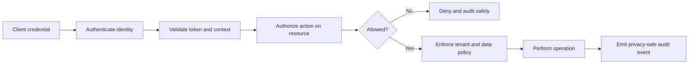

# 16. Security, Identity, and Privacy

## Security is an architectural property
Security controls should follow assets, actors, threats and trust boundaries. A threat model asks what must be protected, who might attack it, what capabilities they have, and what mitigations reduce likelihood or impact. It should be revisited as data flows, integrations and deployment topology change.

## Authentication and authorization
Authentication establishes an identity or credential; authorization decides what that identity may do to a resource. A valid login does not imply permission to read every tenant's data. Enforce authorization at the boundary where the protected operation occurs, not only in the UI.

RBAC assigns permissions through roles. ABAC evaluates attributes such as subject, resource, action and context. Both require clear policy ownership, default-deny behavior, and testing for privilege escalation.

## Sessions, OAuth, OIDC and JWT
A session is server- or client-associated state used to maintain authenticated interaction. Cookies are a browser mechanism for carrying values and need secure attributes, scope and CSRF considerations.

OAuth 2.0 is an authorization framework; OpenID Connect adds an identity layer. JWT is a token format, not an authentication protocol by itself. Token validation must check signature or other applicable protection, issuer, audience, expiry, intended use and relevant claims. Never trust a decoded token merely because its JSON is readable. See [OAuth 2.0 Security Best Current Practice](https://www.rfc-editor.org/rfc/rfc9700.html) and [OpenID Connect specifications](https://openid.net/developers/specs/).

## Encryption and secrets
TLS protects communication in transit; encryption at rest protects stored data under defined key and access assumptions. Neither replaces authorization, secure endpoint configuration or key management. Secrets need controlled distribution, rotation, access auditing and emergency revocation. Avoid embedding credentials in images, logs, source code or client-side applications.

## Least privilege and zero trust
Least privilege grants only the access required for a task. Zero-trust principles avoid treating network location alone as proof of trust; authenticate and authorize requests based on identity, context and policy. Service-to-service identity and authorization should remain meaningful even inside a private network.

## API abuse and tenant isolation
Protect against brute force, credential stuffing, resource exhaustion, oversized payloads, expensive queries, injection and automated abuse. Rate limits need scope and fairness rules; a global limit can allow one tenant to starve others.

Multi-tenant isolation spans application authorization, database queries, cache keys, object paths, queues, logs, backups and administrative tools. A tenant ID filter in one API is not a complete isolation strategy. Test cross-tenant access explicitly.

## Privacy, audit and retention
Collect only data with a defined purpose, restrict access, classify sensitive fields, and set retention/deletion policies. Audit logs should support investigation without becoming a secondary store of secrets. Data deletion must consider replicas, caches, search indexes, analytics copies and backups, with documented exceptions and timelines.

## 16.1A Threat modeling as a repeatable design activity

Threat modeling is most useful before a design is fixed and whenever a major trust boundary or data flow changes. A practical workflow is:
1. Identify assets, sensitive operations, actors, and data classifications.
2. Draw data flows and trust boundaries.
3. Enumerate threats against each boundary and asset.
4. Estimate impact and likelihood under a stated attacker capability.
5. Select preventive, detective, and recovery controls.
6. Record residual risk, owner, and verification evidence.

STRIDE is one common threat-categorization aid: spoofing, tampering, repudiation, information disclosure, denial of service, and elevation of privilege. It is a prompt list, not a guarantee that every threat has been found. Abuse cases and business-specific threats are also important.

## 16.1B Identity lifecycle and credential validation

Identity is more than a token. Consider enrollment, authentication, session refresh, privilege change, credential rotation, revocation, account recovery, and termination. A former employee or compromised service account must lose access through a defined revocation process.

For a signed JWT, validation generally includes signature verification using a trusted key, allowed algorithm policy, issuer, audience, expiry and not-before times where present, intended token type, and required claims. Key discovery and rotation must be bounded and trusted. Do not accept an algorithm merely because the token header names it. A valid signature proves the token was signed by a trusted key; it does not prove the requested resource access is authorized.

Access tokens should have appropriate audience and lifetime. Refresh tokens need stronger protection and rotation/reuse handling according to the identity system. Never place secrets or sensitive personal data in a token merely because it is signed; signed claims are often readable by token holders.

## 16.1C Sessions, cookies, and browser threats

Browser session design must consider theft, fixation, cross-site request forgery (CSRF), cross-site scripting (XSS), and logout/revocation. Secure cookie attributes such as HttpOnly, Secure, and an appropriate SameSite policy reduce specific risks but do not replace output encoding, CSRF controls where needed, or server-side authorization.

A bearer token is usable by whoever possesses it. Keep it out of URLs, logs, analytics, crash reports, and browser storage choices that expose it to scripts where possible. The right design depends on application architecture and threat model; there is no single cookie or token storage strategy that is safe for every application.

## 16.1D Authorization models and object-level checks

RBAC is useful when permissions map naturally to organizational roles. ABAC can express decisions based on subject, resource, action, and environmental attributes. ReBAC models authorization through relationships such as owner, member, manager, or collaborator. Systems may combine these models.

The common failure is checking only whether a user has a broad role, without checking whether that user may access this specific object in this tenant or state. Enforce object-level authorization on every relevant operation, including list, search, export, background job, administrative API, and direct object-storage access. Deny by default and test negative cases explicitly.

## 16.1E Secrets, keys, and cryptographic boundaries

A secret manager reduces hard-coded secret exposure but does not eliminate access-control risk. Define which workload identity may retrieve each secret, how rotation propagates, how old and new credentials overlap, and how emergency revocation works.

Encryption at rest depends on key custody, permissions, backups, and rotation. Envelope encryption commonly encrypts data with a data-encryption key and protects that key with a key-encryption key managed by a key service. Loss or revocation of the wrong key can make data unrecoverable; key backup and recovery must be designed alongside data backup.

TLS certificate renewal, trust-root changes, signing-key rotation, and database credential rotation are production workflows. Test them before expiry rather than treating them as one-time configuration.

## 16.1F Tenant isolation across layers

Tenant isolation is an end-to-end invariant. A tenant boundary must be enforced consistently in:
- API authorization and service-to-service calls.
- Database predicates, row-level policies, and background queries.
- Cache keys and invalidation messages.
- Object-storage keys and signed URLs.
- Message topics, consumer filters, and replay tools.
- Search indexes, analytics exports, logs, and support tooling.
- Backups, restore procedures, and administrative access.

A tenant identifier supplied by a client is input, not proof of membership. Derive the authorized tenant scope from authenticated identity and policy, then apply it consistently. Test cross-tenant reads and writes using adversarial identifiers and alternate access paths.

## 16.1G Privacy lifecycle and data minimization

Privacy engineering starts with purpose and data inventory. For each field, document why it is collected, who can access it, where it is copied, how long it is retained, and how deletion or correction propagates.

Data minimization reduces both breach impact and operational complexity. Avoid collecting sensitive fields “just in case.” Pseudonymization can reduce direct identification but does not necessarily make data anonymous if it can be linked back. Encryption protects confidentiality under key assumptions; it does not itself define a lawful purpose or retention period.

Deletion workflows must account for replicas, caches, derived indexes, event logs, analytics, exports, backups, and legal retention exceptions. Where immediate physical deletion from immutable backups is not feasible, document the policy, access restrictions, expiry timeline, and restoration-time deletion replay.

## 16.1H Security logging and incident readiness

Security logs should record principal, action, target, outcome, timestamp, correlation context, and policy decision where appropriate, while excluding passwords, access tokens, cryptographic keys, and unnecessary sensitive payloads. Logs need integrity protection, access control, retention, and time synchronization appropriate to the investigation.

Design for credential compromise: revoke or rotate credentials, contain affected workloads, identify actions performed, preserve evidence, and restore trusted configuration. Detection without a practiced response path is incomplete protection.

## 16.1I Security design review checklist

- What are the assets and trust boundaries?
- Who authenticates each caller, and how are credentials revoked?
- Where is object-level authorization enforced?
- Can tenant scope be bypassed through another API or background workflow?
- What is the blast radius of a stolen service identity?
- How are secrets and keys rotated and recovered?
- Which data is logged, copied, retained, or deleted?
- What happens if the identity provider is unavailable?
- How are rate limits and expensive operations protected?
- Which negative and cross-tenant tests prove the policy?

## 16.1J OAuth 2.0, OpenID Connect, and token roles in practice

OAuth 2.0 is an authorization framework for delegated access. OpenID Connect (OIDC) adds an authentication layer with an ID token and standardized identity claims. JWT is a token representation that may be used for different purposes; a JWT is not automatically an OAuth access token or an OIDC ID token.

Keep the token roles separate:
- **Access token:** presented to a resource server; validate the intended audience, issuer, lifetime, permissions/scopes and token type according to the profile.
- **ID token:** communicates authentication information to the OIDC client; validate it according to OIDC rules and do not use it as a general API access token.
- **Refresh token:** used with the authorization server to obtain new tokens; protect it as a high-value credential and follow rotation/reuse detection rules supported by the provider.

For browser-based and native public clients, Authorization Code with PKCE is the common modern pattern; the client must validate state and, in OIDC, nonce as appropriate to the flow. Client Credentials is for a confidential client acting as itself, not a substitute for end-user authentication. Avoid legacy flows unless a documented constraint requires them.

Scopes are not a complete authorization decision. The resource server may still need object-level, tenant-level and relationship checks. Token validation also needs key rotation, trusted issuer metadata, algorithm allow-lists, clock-skew policy, and failure behavior when keys cannot be refreshed. Do not log raw tokens.

## 16.2 Threat modeling a system architecture

Threat modeling is a structured way to ask what can go wrong, which assets and trust boundaries matter, and which controls reduce risk. It should begin while architecture is being shaped, not after deployment. A threat model is an explicit set of assumptions and decisions that can be updated when a new component, data flow or trust relationship is introduced.

### Identify assets, actors and trust boundaries

List assets such as credentials, personal data, payment instructions, tenant records, signing keys, service availability and audit evidence. Identify actors: end users, administrators, service identities, third-party providers, compromised clients and automated workers. Draw data flows and mark boundaries where data crosses a browser, edge, service, queue, database, cloud account or external organization.

A trust boundary is not necessarily a network boundary. Two services inside the same cluster may have different permissions and data ownership; two components in one process may have different levels of trust. Every boundary should answer who can call, what identity is asserted, which data may cross, and how the receiver validates it.

### Abuse cases and control mapping

Ask how an attacker or faulty caller could read another tenant's object, escalate privileges, replay a command, exhaust expensive resources, trick the service into calling an internal endpoint, poison a cache, misuse a webhook, or alter a deployment artifact. Map each threat to preventive controls, detection signals, and recovery steps.

For example, SSRF defenses should constrain destinations and redirect behavior, validate resolved addresses where appropriate, and protect metadata endpoints; a URL syntax check alone is not enough. API resource-abuse defenses may need payload caps, pagination, query complexity limits, concurrency quotas and per-tenant budgets—not only request-per-second limits.

### Authentication, authorization and identity propagation

Authentication establishes which principal is making a request; authorization decides whether that principal may perform the action on the specific resource under current policy. Role-based access control (RBAC) assigns permissions through roles; attribute-based access control (ABAC) evaluates attributes such as subject, resource, action and context. Relationship-based models can express access derived from ownership or sharing relationships.

Do not assume that a valid JWT means the caller is authorized. Validate issuer, audience, expiry, token purpose and cryptographic profile; then perform the resource-level policy check. When identity crosses service boundaries, define whether the caller's identity is delegated, exchanged for a service token, or represented as a trusted assertion. Never trust client-supplied identity headers without a protected, verified propagation path.

### Zero trust, least privilege and service identity

Zero trust means do not grant implicit trust solely because a request originates on an internal network. Authenticate and authorize principals, minimize permissions, and evaluate access according to the resource and context. This does not mean every request must call a central policy server synchronously; policy caching and local enforcement can be designed with explicit freshness and revocation trade-offs.

Service identity and mutual TLS can authenticate workloads and protect traffic between services, but transport identity does not replace application authorization. Rotate credentials, define trust roots, limit certificate scope and lifetime, and plan for identity-provider or certificate-authority outages.

### Secrets, encryption and key lifecycle

Encryption in transit and at rest protects different exposure paths. Key management must define generation, storage, access, rotation, backup, revocation and destruction. Rotation needs overlap where old and new keys coexist, and services must reload credentials without causing a fleet-wide reconnect storm.

Secrets should not be embedded in container images, source repositories, build logs, crash dumps or ordinary application telemetry. Access should be auditable and narrowly scoped. If a secret is exposed, revoking it is not enough if the same credential was copied into multiple systems; identify all uses and rotate the full dependency chain.

### Multi-tenant isolation and privacy lifecycle

Tenant isolation should be enforced at every layer: API authorization, cache keys, database queries, object-storage paths, search filters, background jobs, analytics exports and operational tools. A tenant ID supplied by the client is an input, not proof of authority. Use explicit tenant context derived from an authenticated identity and propagate it safely.

Privacy requires data minimization, purpose limitation, retention, deletion, export, access logging and control over derived copies. Deleting a source row may not delete caches, search indexes, analytics tables, backups or event logs immediately. Define what deletion means for each storage class, the allowed delay, and any legal retention exception.

### Security design checklist

- What assets are most sensitive and what are the abuse cases?
- Where are the trust boundaries, including internal service boundaries?
- Is every resource access authorized at the resource owner?
- Can a tenant identifier, object ID or forwarded header be spoofed?
- Are API cost, payload size and concurrency bounded?
- How are secrets and signing keys rotated and revoked?
- What happens when identity or key-distribution dependencies fail?
- Can sensitive data leak through logs, caches, search, backups or analytics?
- How are security events correlated and investigated?
- Is there a tested response for credential compromise or tenant-isolation failure?

## Further reading
- IETF [RFC 9700 — OAuth 2.0 Security BCP](https://www.rfc-editor.org/rfc/rfc9700.html).
- OpenID Foundation [specifications](https://openid.net/developers/specs/).
- NIST [Cybersecurity Framework](https://www.nist.gov/cyberframework).

## A request crosses trust boundaries

Authentication, token validation, authorization and tenant isolation are separate checks. Passing one must not imply the others. Audit records should capture enough for investigation without logging credentials or unnecessary sensitive payloads.

---

[Back to textbook contents](../../README.md) · [Curriculum](../../CURRICULUM.md) · [Roadmap](../../ROADMAP.md)
