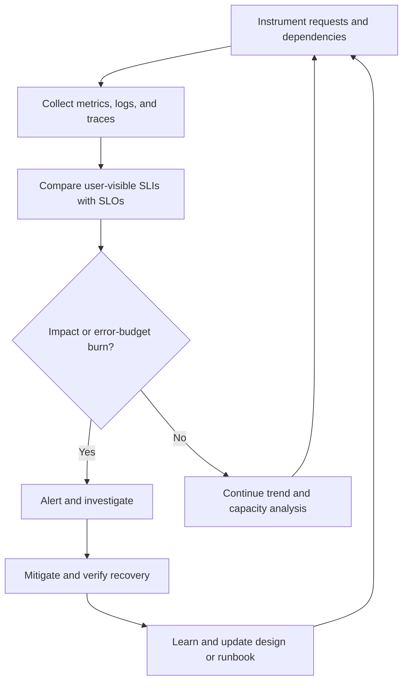

# 17. Observability and Operating Production Systems

## Signals and their roles
- **Logs** record discrete events with context.
- **Metrics** aggregate numeric measurements over time.
- **Traces** connect spans across a request or workflow.

Structured logs make fields queryable. Correlation and trace IDs help connect events, but IDs should not contain secrets or unbounded user data. Context propagation must cross asynchronous boundaries and be handled safely at trust boundaries.

## RED and USE
RED focuses on Rate, Errors and Duration for request-driven services. USE focuses on Utilization, Saturation and Errors for resources. They are complementary heuristics, not complete observability strategies. A service may show normal CPU but be saturated on a connection pool or blocked on a remote dependency.

## Percentiles and cardinality
Latency percentiles describe distributions; averages can conceal slow requests. Histograms or equivalent aggregations are needed to estimate quantiles meaningfully across instances. Aggregating per-instance p99 values by taking their arithmetic mean is generally not the fleet-wide p99.

Metric cardinality grows when labels have many possible values. User IDs, request IDs and arbitrary URLs can make metrics expensive and noisy; put high-cardinality details in traces or logs when appropriate, with privacy controls.

## SLO-driven alerting
An SLI should represent user-visible success, such as successful eligible requests within a latency target. An SLO sets a target over a window. Error-budget burn rates can alert when a service consumes its allowed failure budget too quickly. Alert on actionable symptoms and user impact rather than every internal anomaly.

## Tracing and diagnosis
Distributed traces reveal the time spent in application spans and dependencies, but sampling can omit rare failures and clock differences complicate cross-host timing. Instrument retries and queue wait separately from service time. A span's duration is not necessarily CPU time.

A practical investigation flow:
1. Confirm user impact and affected scope.
2. Check error rate, latency percentiles and traffic changes.
3. Compare dependency and resource saturation signals.
4. Trace representative slow or failed requests.
5. Form a hypothesis and test it against evidence.
6. Mitigate safely, then verify recovery.
7. Preserve evidence and track corrective actions.

## Production readiness
A production-ready service needs ownership, dashboards, alerts, runbooks, capacity assumptions, deployment/rollback plans, security review, backup and restore evidence, dependency budgets and incident escalation. Operational readiness is not just a final checklist; it influences architecture.

## Further reading
- [OpenTelemetry documentation](https://opentelemetry.io/docs/).
- Google [Site Reliability Engineering book](https://sre.google/sre-book/table-of-contents/).

## Observability is a feedback loop

Metrics reveal patterns, logs add event context, and traces connect work across services. None is sufficient alone for every incident; correlation and low-cardinality labels matter.

---

[Back to textbook contents](../../README.md) · [Curriculum](../../CURRICULUM.md) · [Roadmap](../../ROADMAP.md)
