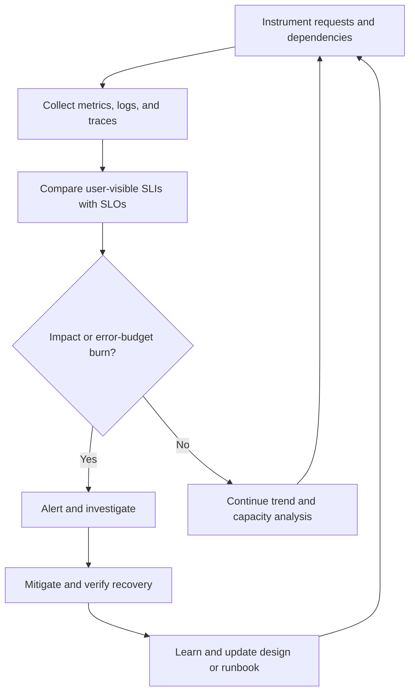

# 17. Observability and Operating Production Systems

## Signals and their roles
- **Logs** record discrete events with context.
- **Metrics** aggregate numeric measurements over time.
- **Traces** connect spans across a request or workflow.

Structured logs make fields queryable. Correlation and trace IDs help connect events, but IDs should not contain secrets or unbounded user data. Context propagation must cross asynchronous boundaries and be handled safely at trust boundaries.

## RED and USE
RED focuses on Rate, Errors and Duration for request-driven services. USE focuses on Utilization, Saturation and Errors for resources. They are complementary heuristics, not complete observability strategies. A service may show normal CPU but be saturated on a connection pool or blocked on a remote dependency.

## Percentiles and cardinality
Latency percentiles describe distributions; averages can conceal slow requests. Histograms or equivalent aggregations are needed to estimate quantiles meaningfully across instances. Aggregating per-instance p99 values by taking their arithmetic mean is generally not the fleet-wide p99.

Metric cardinality grows when labels have many possible values. User IDs, request IDs and arbitrary URLs can make metrics expensive and noisy; put high-cardinality details in traces or logs when appropriate, with privacy controls.

## SLO-driven alerting
An SLI should represent user-visible success, such as successful eligible requests within a latency target. An SLO sets a target over a window. Error-budget burn rates can alert when a service consumes its allowed failure budget too quickly. Alert on actionable symptoms and user impact rather than every internal anomaly.

## Tracing and diagnosis
Distributed traces reveal the time spent in application spans and dependencies, but sampling can omit rare failures and clock differences complicate cross-host timing. Instrument retries and queue wait separately from service time. A span's duration is not necessarily CPU time.

A practical investigation flow:
1. Confirm user impact and affected scope.
2. Check error rate, latency percentiles and traffic changes.
3. Compare dependency and resource saturation signals.
4. Trace representative slow or failed requests.
5. Form a hypothesis and test it against evidence.
6. Mitigate safely, then verify recovery.
7. Preserve evidence and track corrective actions.

## Production readiness
A production-ready service needs ownership, dashboards, alerts, runbooks, capacity assumptions, deployment/rollback plans, security review, backup and restore evidence, dependency budgets and incident escalation. Operational readiness is not just a final checklist; it influences architecture.

## 17.1A Instrumentation boundaries and context propagation

Observability data should preserve enough context to connect an external request to its internal work without turning identifiers into high-cardinality metric labels. A trace context can flow through HTTP headers, message metadata, and asynchronous task boundaries. At trust boundaries, validate or replace untrusted context rather than blindly accepting arbitrary baggage.

A trace ID correlates work; it is not an authentication credential. Do not use trace context to make authorization decisions. Background jobs and message consumers should link their processing to the originating operation where appropriate, while also representing long delays and retries accurately.

## 17.1B Metrics: counters, gauges, histograms, and cardinality

- **Counter:** monotonically increasing event total, such as requests or failures.
- **Gauge:** current value that can rise or fall, such as queue depth or active connections.
- **Histogram:** observations bucketed by value, useful for latency and size distributions.
- **Summary:** a metric type that may calculate quantiles locally; aggregation behavior depends on the implementation.

Use counters for rates after calculating deltas over time; do not interpret a process-reset counter as a negative event. Gauges require clear semantics about when they are sampled. Histograms should have buckets appropriate to the target thresholds, and fleet-wide quantiles should be calculated from aggregatable distribution data rather than averaging instance p99 values.

Cardinality multiplies across labels. A metric with labels for tenant, user, URL, and request ID can create an unbounded series count. Keep labels bounded and use logs or traces for high-cardinality details with access and privacy controls.

## 17.1C Histograms, percentiles, and tail interpretation

Percentiles depend on sample size, aggregation, time window, and bucket resolution. A p99 over ten requests is a weak indicator of rare tail behavior. Aggregating per-instance quantiles by arithmetic mean does not produce the fleet quantile. Use histograms or a suitable mergeable distribution.

Latency should be measured at meaningful boundaries: client-visible end-to-end duration, service handler duration, queue wait, connection acquisition, and dependency duration answer different questions. Instrument retries separately so a successful final response does not conceal repeated failed attempts or excessive work.

## 17.1D Logs and traces are evidence with limitations

Structured logs should include stable event names and useful fields such as operation, result, dependency, duration, and correlation identifiers. Avoid logging secrets, full tokens, and unnecessary personal data. Sampling, buffering, and dropped telemetry mean absence of a log line is not proof that an event did not occur.

A trace shows spans and causal relationships as instrumented, but instrumentation gaps, sampling, asynchronous work, and clock differences can complicate interpretation. A long span may include waiting rather than CPU execution. Correlate traces with resource metrics and application-level state transitions.

## 17.1E SLOs, alerting, and burn rate

An SLI needs an explicit good-event definition and eligible-event denominator. An SLO needs a target and window. Alerting should focus on user impact or rapid loss of error budget rather than every threshold crossing.

A burn rate compares the observed error rate with the allowed error rate implied by the SLO. Multi-window alerting can detect both fast severe incidents and slower sustained degradation. The right windows depend on traffic volume, service criticality, and response expectations; avoid alerts so sensitive that routine variation pages the team constantly.

A dashboard is not an alerting strategy. Each page should have an owner, an actionable next step, and enough context to assess impact. Alerts without a response path create noise rather than reliability.

## 17.1F Capacity and saturation observability

Monitor the constrained resource, not only CPU. Useful signals include queue depth and age, worker utilization, thread-pool rejection, connection acquisition latency, database lock waits, cache miss load, consumer lag, disk latency, network retransmissions, and rate-limit rejection.

A growing queue can indicate the system is accepting more work than it can complete. Queue depth alone is insufficient if arrival rate is low; queue age and drain rate provide context. A system may have low CPU while waiting on exhausted connections or a slow dependency.

## 17.1G Incident diagnosis and runbooks

A practical incident sequence is:
1. Establish customer impact, scope, and start time.
2. Check traffic, success rate, latency percentiles, and saturation.
3. Identify the first failing or slowing dependency in traces and logs.
4. Compare current behavior with a known baseline and recent changes.
5. Form a falsifiable hypothesis and test it with evidence.
6. Mitigate using a reversible, bounded action where possible.
7. Verify customer-facing recovery and data correctness.
8. Preserve evidence, communicate status, and track follow-up work.

Runbooks should state symptoms, safe checks, mitigation steps, expected signals, abort conditions, escalation paths, and verification criteria. Avoid blindly restarting components when doing so may destroy evidence, worsen a thundering herd, or interrupt recovery.

## 17.1H Operational readiness checklist

- Service owner and escalation path are known.
- SLIs/SLOs and error-budget policy are defined.
- Dashboards show user impact and constrained resources.
- Alerts are actionable and tested.
- Traces and logs carry safe correlation context.
- Capacity and dependency limits are documented.
- Rollout and rollback steps are rehearsed.
- Backup restore and disaster recovery have evidence.
- Secrets and access are controlled.
- Runbooks define verification and safe abort conditions.

## Further reading
- [OpenTelemetry documentation](https://opentelemetry.io/docs/).
- Google [Site Reliability Engineering book](https://sre.google/sre-book/table-of-contents/).

## Observability is a feedback loop

Metrics reveal patterns, logs add event context, and traces connect work across services. None is sufficient alone for every incident; correlation and low-cardinality labels matter.

---

[Back to textbook contents](../../README.md) · [Curriculum](../../CURRICULUM.md) · [Roadmap](../../ROADMAP.md)
