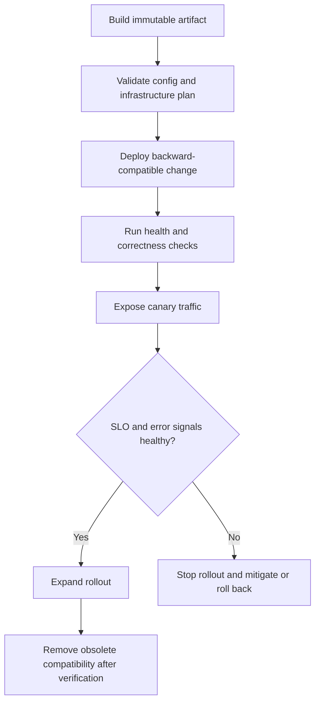

# 18. Cloud Infrastructure and Delivery

## Cloud primitives
Cloud service models are commonly described as IaaS, PaaS and SaaS, but provider boundaries vary. Architecturally, systems still need compute, network, identity, storage, observability and recovery. Managed services transfer some operational responsibilities to a provider; they do not remove the need to understand quotas, failure behavior, backups, regional dependencies or cost.

Regions and availability zones represent infrastructure failure domains, but their exact independence and connectivity are provider-specific. Deploying across zones helps only if traffic routing, state replication, capacity and failover behavior are designed accordingly.

## Containers and Kubernetes
Containers package a process with its dependencies and use operating-system isolation primitives; they are not virtual machines with a separate kernel in the usual container model. Kubernetes coordinates workloads through API objects and controllers. It can restart and reschedule containers, but it cannot make an application stateless, fix a broken database query, or guarantee that a replacement is instantly ready.

Resource requests influence scheduling; limits constrain resource use according to resource-specific behavior. CPU throttling can increase latency; memory limit breaches may terminate a container. Readiness, liveness and startup probes have different purposes. An overly aggressive liveness probe can turn a slow dependency into repeated restarts. See [Kubernetes architecture](https://kubernetes.io/docs/concepts/architecture/), [resource management](https://kubernetes.io/docs/concepts/configuration/manage-resources-containers/), and [probe guidance](https://kubernetes.io/docs/concepts/configuration/liveness-readiness-startup-probes/).

## Managed versus self-hosted
Managed services can reduce operational burden and provide integrated recovery features, but introduce provider-specific APIs, quotas, pricing and portability constraints. Self-hosting offers control but requires staffing, patching, upgrades, monitoring, backup, capacity planning and incident response. Compare total operational cost, not just service price.

## Infrastructure as code and configuration
Infrastructure as code makes desired infrastructure reviewable and repeatable. State drift, secrets, destructive plans and dependency ordering remain risks. Separate configuration from immutable artifacts, validate changes, use least-privilege deployment identities, and preserve rollback paths.

## Delivery strategies
- **Rolling deployment:** gradually replaces instances; old and new versions coexist.
- **Blue-green:** maintains two environments and switches traffic, requiring compatible data and capacity.
- **Canary:** exposes a small traffic cohort to a change and evaluates signals before expanding.
- **Feature flags:** decouple code deployment from behavior activation, but stale flags create complexity and security risk.

Rollback is not always a code-only operation. Database migrations, emitted events and external side effects may not be reversible. Design backward-compatible deployment steps and define what metrics stop rollout.

## Cost as a design dimension
Costs include compute, storage, data transfer, managed-service requests, replication, observability, backups, idle capacity and engineering operations. Cross-region transfer and chatty service boundaries can dominate. Optimize for cost per useful successful operation while preserving reliability and security objectives.

## 18.1A Cloud responsibility boundaries

Cloud service models distribute operational responsibility differently, but responsibility is never simply “the provider handles everything.” Clarify who patches the guest OS or runtime, configures identity, rotates secrets, protects data, defines network rules, tests restore, monitors quotas, and responds to incidents.

Managed databases may handle software patching and replication orchestration while leaving schema design, query performance, access policy, backup configuration, restore testing, and application-level correctness to the customer. Review the provider's shared-responsibility model and the exact service contract.

## 18.1B Region, zone, and dependency topology

A region is a geographic deployment area; zones are intended to provide some isolation within a region, but their exact architecture and failure independence are provider-specific. Multi-zone deployment helps only if the application, data layer, routing, capacity, identity, and operational procedures also tolerate a zone loss.

Map dependencies by failure domain: compute, storage, control plane, DNS, identity, network, secrets, observability, and external SaaS providers. Two replicas may share one hidden dependency, such as a global identity service or one deployment pipeline. Redundancy should be evaluated against the actual outage being mitigated.

## 18.1C Kubernetes controllers, probes, and resource behavior

Kubernetes controllers reconcile observed state toward desired state. Reconciliation is asynchronous: creating a Deployment does not mean all Pods are scheduled, started, ready, or able to serve production traffic.

- **Startup probe** gives a slow-starting container time before liveness checks apply.
- **Liveness probe** detects a process that should be restarted.
- **Readiness probe** determines whether the instance should receive traffic.
- **Resource requests** influence scheduling and capacity placement.
- **Resource limits** constrain resource use according to the resource type and runtime.

A readiness check should reflect whether the instance can safely serve its role, but a probe that depends on every shared downstream service can remove all replicas during one dependency outage. Liveness should generally avoid restarting a healthy process merely because a remote dependency is temporarily unavailable.

CPU limits can cause throttling; memory-limit breaches may result in termination. Pod disruption budgets, topology spread, graceful termination, startup time, and capacity during node drain all affect availability. Kubernetes rescheduling is not instantaneous failover and does not replace application-level retries, idempotency, or state recovery.

## 18.1D Containers, images, and supply chain

Containers share the host kernel in common implementations, so isolation depends on kernel features, runtime configuration, privileges, and host security. Use minimal trusted base images, pin and scan dependencies, avoid unnecessary capabilities, run as non-root where feasible, and keep secrets out of image layers.

An image digest identifies artifact content more reliably than a mutable tag. A secure delivery pipeline should protect source control, build credentials, artifact registry, signing keys, deployment identity, and provenance. Build reproducibility and artifact signing can help establish what was deployed, but they do not prove the application logic is free of vulnerabilities.

## 18.1E Infrastructure as code and state safety

Infrastructure as code makes changes reviewable and repeatable, but state files can contain sensitive data and represent ownership of real resources. Protect state access, locking, backups, and recovery. Review plans for destructive replacement, dependency ordering, drift, and unintended exposure before applying changes.

Separate reusable modules from environment-specific configuration without hiding important security or networking decisions. Use least-privilege identities for plan/apply workflows, protect production approvals, and test rollback or forward-fix procedures. A successful infrastructure deployment does not imply the application is healthy.

## 18.1F Progressive delivery and data compatibility

Rolling, canary, and blue-green deployments each require old and new versions to coexist or a controlled switch between them. Database schema and event changes must remain compatible across this overlap.

A safe migration commonly uses expand-and-contract:
1. Add a compatible field or structure.
2. Deploy code that tolerates both representations.
3. Backfill and verify.
4. Switch reads/writes in a controlled sequence.
5. Stop using the old representation.
6. Remove it only after old code and consumers are gone.

Rollback criteria should include error rate, latency, business correctness, resource saturation, and dependency health. If the new version emitted irreversible external effects or changed persisted data, rolling back the binary may not restore the prior state. Plan compensating actions or forward-fix options.

## 18.1G Cost, quotas, and cloud failure modes

Cloud cost includes idle reservations, cross-zone and cross-region transfer, managed requests, logs and traces, backup retention, replication, egress, support, and engineering operations. A chatty architecture may have modest compute use but high network or managed-service request charges.

Quotas are capacity constraints and can cause partial outages when traffic grows or failover concentrates work. Understand per-region, per-account, per-service, and burst quotas. Design graceful behavior for quota exhaustion and request increases before a planned scale event. Autoscaling cannot exceed quotas or provision instantly during a sudden burst.

## 18.1H Cloud delivery checklist

- Failure domains and hidden shared dependencies are mapped.
- IAM and deployment identities use least privilege.
- Images and artifacts are traceable and protected.
- Resource requests, limits, probes, and termination behavior are tested.
- Quotas and failover capacity are known.
- Infrastructure state is protected and recoverable.
- Database and event schema changes are backward compatible.
- Rollout stop conditions and rollback/forward-fix plans are explicit.
- Restore and disaster-recovery procedures are tested.
- Cost includes transfer, observability, backups, and operational work.

## Further reading
- Docker [container fundamentals](https://docs.docker.com/get-started/docker-concepts/the-basics/what-is-a-container/).
- Kubernetes [documentation](https://kubernetes.io/docs/home/).
- AWS [Well-Architected Framework](https://docs.aws.amazon.com/wellarchitected/latest/framework/welcome.html).

## Safe delivery through compatible states

Rollback can be unsafe if the new version has already changed data or emitted incompatible events. Prefer expand-and-contract migrations and make rollback criteria explicit before deployment.

---

[Back to textbook contents](../../README.md) · [Curriculum](../../CURRICULUM.md) · [Roadmap](../../ROADMAP.md)
