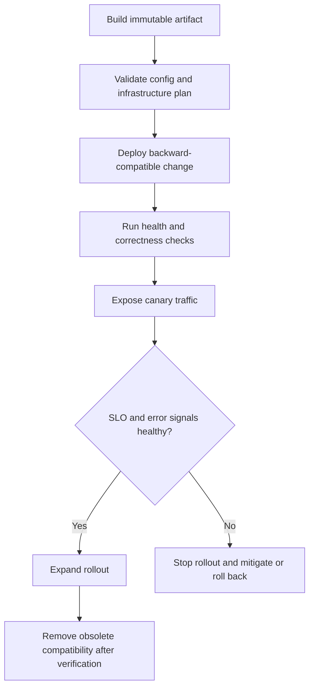

# 18. Cloud Infrastructure and Delivery

## Cloud primitives
Cloud service models are commonly described as IaaS, PaaS and SaaS, but provider boundaries vary. Architecturally, systems still need compute, network, identity, storage, observability and recovery. Managed services transfer some operational responsibilities to a provider; they do not remove the need to understand quotas, failure behavior, backups, regional dependencies or cost.

Regions and availability zones represent infrastructure failure domains, but their exact independence and connectivity are provider-specific. Deploying across zones helps only if traffic routing, state replication, capacity and failover behavior are designed accordingly.

## Containers and Kubernetes
Containers package a process with its dependencies and use operating-system isolation primitives; they are not virtual machines with a separate kernel in the usual container model. Kubernetes coordinates workloads through API objects and controllers. It can restart and reschedule containers, but it cannot make an application stateless, fix a broken database query, or guarantee that a replacement is instantly ready.

Resource requests influence scheduling; limits constrain resource use according to resource-specific behavior. CPU throttling can increase latency; memory limit breaches may terminate a container. Readiness, liveness and startup probes have different purposes. An overly aggressive liveness probe can turn a slow dependency into repeated restarts. See [Kubernetes architecture](https://kubernetes.io/docs/concepts/architecture/), [resource management](https://kubernetes.io/docs/concepts/configuration/manage-resources-containers/), and [probe guidance](https://kubernetes.io/docs/concepts/configuration/liveness-readiness-startup-probes/).

## Managed versus self-hosted
Managed services can reduce operational burden and provide integrated recovery features, but introduce provider-specific APIs, quotas, pricing and portability constraints. Self-hosting offers control but requires staffing, patching, upgrades, monitoring, backup, capacity planning and incident response. Compare total operational cost, not just service price.

## Infrastructure as code and configuration
Infrastructure as code makes desired infrastructure reviewable and repeatable. State drift, secrets, destructive plans and dependency ordering remain risks. Separate configuration from immutable artifacts, validate changes, use least-privilege deployment identities, and preserve rollback paths.

## Delivery strategies
- **Rolling deployment:** gradually replaces instances; old and new versions coexist.
- **Blue-green:** maintains two environments and switches traffic, requiring compatible data and capacity.
- **Canary:** exposes a small traffic cohort to a change and evaluates signals before expanding.
- **Feature flags:** decouple code deployment from behavior activation, but stale flags create complexity and security risk.

Rollback is not always a code-only operation. Database migrations, emitted events and external side effects may not be reversible. Design backward-compatible deployment steps and define what metrics stop rollout.

## Cost as a design dimension
Costs include compute, storage, data transfer, managed-service requests, replication, observability, backups, idle capacity and engineering operations. Cross-region transfer and chatty service boundaries can dominate. Optimize for cost per useful successful operation while preserving reliability and security objectives.

## 18.1A Cloud responsibility boundaries

Cloud service models distribute operational responsibility differently, but responsibility is never simply “the provider handles everything.” Clarify who patches the guest OS or runtime, configures identity, rotates secrets, protects data, defines network rules, tests restore, monitors quotas, and responds to incidents.

Managed databases may handle software patching and replication orchestration while leaving schema design, query performance, access policy, backup configuration, restore testing, and application-level correctness to the customer. Review the provider's shared-responsibility model and the exact service contract.

## 18.1B Region, zone, and dependency topology

A region is a geographic deployment area; zones are intended to provide some isolation within a region, but their exact architecture and failure independence are provider-specific. Multi-zone deployment helps only if the application, data layer, routing, capacity, identity, and operational procedures also tolerate a zone loss.

Map dependencies by failure domain: compute, storage, control plane, DNS, identity, network, secrets, observability, and external SaaS providers. Two replicas may share one hidden dependency, such as a global identity service or one deployment pipeline. Redundancy should be evaluated against the actual outage being mitigated.

## 18.1C Kubernetes controllers, probes, and resource behavior

Kubernetes controllers reconcile observed state toward desired state. Reconciliation is asynchronous: creating a Deployment does not mean all Pods are scheduled, started, ready, or able to serve production traffic.

- **Startup probe** gives a slow-starting container time before liveness checks apply.
- **Liveness probe** detects a process that should be restarted.
- **Readiness probe** determines whether the instance should receive traffic.
- **Resource requests** influence scheduling and capacity placement.
- **Resource limits** constrain resource use according to the resource type and runtime.

A readiness check should reflect whether the instance can safely serve its role, but a probe that depends on every shared downstream service can remove all replicas during one dependency outage. Liveness should generally avoid restarting a healthy process merely because a remote dependency is temporarily unavailable.

CPU limits can cause throttling; memory-limit breaches may result in termination. Pod disruption budgets, topology spread, graceful termination, startup time, and capacity during node drain all affect availability. Kubernetes rescheduling is not instantaneous failover and does not replace application-level retries, idempotency, or state recovery.

## 18.1D Containers, images, and supply chain

Containers share the host kernel in common implementations, so isolation depends on kernel features, runtime configuration, privileges, and host security. Use minimal trusted base images, pin and scan dependencies, avoid unnecessary capabilities, run as non-root where feasible, and keep secrets out of image layers.

An image digest identifies artifact content more reliably than a mutable tag. A secure delivery pipeline should protect source control, build credentials, artifact registry, signing keys, deployment identity, and provenance. Build reproducibility and artifact signing can help establish what was deployed, but they do not prove the application logic is free of vulnerabilities.

## 18.1E Infrastructure as code and state safety

Infrastructure as code makes changes reviewable and repeatable, but state files can contain sensitive data and represent ownership of real resources. Protect state access, locking, backups, and recovery. Review plans for destructive replacement, dependency ordering, drift, and unintended exposure before applying changes.

Separate reusable modules from environment-specific configuration without hiding important security or networking decisions. Use least-privilege identities for plan/apply workflows, protect production approvals, and test rollback or forward-fix procedures. A successful infrastructure deployment does not imply the application is healthy.

## 18.1F Progressive delivery and data compatibility

Rolling, canary, and blue-green deployments each require old and new versions to coexist or a controlled switch between them. Database schema and event changes must remain compatible across this overlap.

A safe migration commonly uses expand-and-contract:
1. Add a compatible field or structure.
2. Deploy code that tolerates both representations.
3. Backfill and verify.
4. Switch reads/writes in a controlled sequence.
5. Stop using the old representation.
6. Remove it only after old code and consumers are gone.

Rollback criteria should include error rate, latency, business correctness, resource saturation, and dependency health. If the new version emitted irreversible external effects or changed persisted data, rolling back the binary may not restore the prior state. Plan compensating actions or forward-fix options.

## 18.1G Cost, quotas, and cloud failure modes

Cloud cost includes idle reservations, cross-zone and cross-region transfer, managed requests, logs and traces, backup retention, replication, egress, support, and engineering operations. A chatty architecture may have modest compute use but high network or managed-service request charges.

Quotas are capacity constraints and can cause partial outages when traffic grows or failover concentrates work. Understand per-region, per-account, per-service, and burst quotas. Design graceful behavior for quota exhaustion and request increases before a planned scale event. Autoscaling cannot exceed quotas or provision instantly during a sudden burst.

## 18.1H Cloud delivery checklist

- Failure domains and hidden shared dependencies are mapped.
- IAM and deployment identities use least privilege.
- Images and artifacts are traceable and protected.
- Resource requests, limits, probes, and termination behavior are tested.
- Quotas and failover capacity are known.
- Infrastructure state is protected and recoverable.
- Database and event schema changes are backward compatible.
- Rollout stop conditions and rollback/forward-fix plans are explicit.
- Restore and disaster-recovery procedures are tested.
- Cost includes transfer, observability, backups, and operational work.

## 18.1I Cloud service models and placement trade-offs

Cloud service models describe which layers the provider operates, but exact responsibility depends on the product:
- **Infrastructure as a Service (IaaS):** the customer commonly manages guest operating systems, runtime, application and much of the network/security configuration, while the provider manages physical infrastructure and virtualization.
- **Platform as a Service (PaaS):** the provider manages more of the runtime platform; the customer still owns application behavior, identity policy, data protection and configuration.
- **Software as a Service (SaaS):** the provider operates the application, while the customer still manages appropriate access, configuration, data governance and user lifecycle.

Serverless is an execution and operations model rather than a universal synonym for PaaS. It can reduce server management but introduces quotas, cold-start or scale-from-zero behavior, execution limits, provider-specific event semantics, and sometimes stronger coupling to managed services.

Placement choices include virtual machines, containers on managed orchestration, managed application platforms, functions, and managed data services. Compare them by startup behavior, scaling granularity, isolation, runtime control, operational burden, portability, quotas, network topology, observability, and cost under idle and peak load. The most abstract service is not automatically the cheapest or most reliable for every workload.

## 18.2 Kubernetes architecture and runtime behavior

Kubernetes is a control system for desired state, not simply a command that starts containers. A workload declares a desired number of replicas and configuration; controllers observe actual state and attempt to reconcile it toward that desired state. Reconciliation is asynchronous, so an API request being accepted does not mean the workload is already ready to serve.

### Control plane and worker-node responsibilities

The API server exposes the cluster API; durable cluster state is stored in the backing data store; the scheduler assigns unscheduled Pods to nodes; controllers reconcile resources; and node agents work with the container runtime to run assigned workloads. Networking and storage are provided by cluster components and plugins, with behavior depending on the distribution and configuration.

The control plane may be healthy while a workload is not schedulable due to resource requests, affinity, taints, quotas, unavailable volumes or image-pull failures. Conversely, existing Pods can sometimes continue running through a temporary control-plane problem, while new scheduling and reconciliation are impaired. Diagnose the failing layer rather than treating “Kubernetes is down” as one failure mode.

### Pods, Deployments, Services and Ingress

A Pod is the scheduling unit and can contain one or more tightly coupled containers sharing network identity and selected volumes. A Deployment manages a replica set and rollout behavior for stateless-style replicated Pods. A Service provides a stable logical endpoint for a set of endpoints; it does not mean the application is ready or that every request will succeed. Ingress or a gateway controller implements external HTTP routing according to its controller and platform.

A Service selector, readiness configuration and endpoint propagation determine which Pods receive traffic. During rollout, old and new versions may coexist; contracts and database schemas must remain compatible. Long-lived connections may delay termination unless graceful shutdown and draining are configured.

### Requests, limits, scheduling and noisy neighbors

Resource requests influence scheduling and are commonly used for capacity accounting. CPU limits can throttle a container; memory-limit breaches can trigger termination by the runtime/kernel. Setting requests too low leads to overpacking and contention; setting them too high wastes cluster capacity or leaves Pods pending. A Pod's declared resources should reflect observed steady-state and burst behavior, not arbitrary round numbers.

CPU, memory, ephemeral storage, file descriptors, connection counts and downstream quotas are all finite. Autoscaling replicas cannot fix a single-threaded bottleneck, a database limit, or a hot key. Resource limits should be evaluated alongside JVM/GC behavior, native memory, thread pools and per-Pod concurrency.

### Liveness, readiness and startup probes

- **Startup probe:** gives slow-starting applications time to initialize before liveness checking takes effect.
- **Readiness probe:** controls whether a Pod should receive new service traffic.
- **Liveness probe:** detects a condition where restarting the process may help.

A bad liveness probe can create a restart loop during a dependency outage, removing otherwise useful capacity and worsening the incident. A readiness probe that depends on every downstream system can remove all endpoints simultaneously. Choose each probe based on the action it triggers and test its behavior during partial failure.

### Autoscaling and disruption

Horizontal Pod Autoscaling adjusts replica count based on configured metrics; cluster autoscaling may add or remove nodes. These loops have delays and quotas. Scaling Pods without available node capacity leaves them pending; adding nodes may take time and can itself create image-pull, connection-establishment or cache-warmup spikes.

Pod disruption budgets can limit some voluntary disruptions but do not guarantee application availability during all failures. Spread replicas across failure domains, account for topology and capacity, and ensure the service can survive the loss of a node or zone. Replica count alone does not prove redundancy if every replica depends on one database or one zone.

### Configuration, secrets and delivery safety

ConfigMaps and Secrets have different sensitivity expectations, but neither removes the need for access control and safe handling. Avoid putting secrets in images, logs or source control. Rotation must account for application reload behavior, connection reuse and overlap between old and new credentials.

Progressive delivery can use rolling updates, blue/green environments, or canary traffic. A safe rollback requires more than reverting an image: database changes, messages already emitted, external side effects and configuration may not be reversible. Prefer expand-and-contract schema changes and explicit rollback/forward-fix plans.

### Kubernetes review checklist

- Is the desired state schedulable with current requests, quotas and affinity?
- Are readiness, liveness and startup probes semantically distinct?
- Can replicas be placed across independent failure domains?
- What happens to in-flight requests during termination?
- Can scale-out overload the database or external dependencies?
- Are resource limits consistent with runtime/GC and concurrency behavior?
- Are configuration and secrets versioned, protected and rotatable?
- Can rollout be paused or rolled back safely?
- Are Pod pending, restart, throttling, OOM, endpoint and scheduling signals monitored?
- Has recovery been tested without relying on replica count as the only redundancy measure?

## 18.3 Service mesh and east-west traffic

A service mesh commonly provides service-to-service traffic capabilities such as workload identity, mutual TLS, retries/timeouts, routing policy, telemetry and sometimes authorization through proxies and a control plane. Exact features depend on the mesh implementation and configuration; the label does not guarantee that every request is secure or resilient.

### Data plane and control plane

The **data plane** handles application traffic, often through sidecar or node-level proxies. The **control plane** distributes identity material and traffic configuration, manages policy and reports status. A control-plane outage may leave existing data-plane proxies using last-known configuration while new policy or certificate updates fail; this behavior is implementation-specific and should be tested.

A sidecar adds a hop, CPU/memory consumption, configuration and its own failure behavior. A node-level proxy can reduce per-Pod overhead but changes isolation and rollout characteristics. Decide based on workload density, latency budget, operational complexity and required policy enforcement.

### Identity and authorization between services

Mutual TLS can authenticate workloads and protect traffic in transit. A certificate or workload identity identifies the caller, but the receiving service still needs authorization rules for the operation and resource. Define identity issuance, trust roots, rotation, expiry, revocation and behavior when identity infrastructure is unavailable. Do not rely only on a namespace or network location as proof of identity.

### Retries, timeouts and traffic policy

A mesh can centralize traffic policy, but a retry configured at the proxy can multiply retries already implemented in the client or gateway. Establish one end-to-end deadline and a single retry budget; do not blindly retry non-idempotent operations. Outlier ejection can temporarily remove slow or failing endpoints, but aggressive ejection can leave too few targets and overload the remainder.

Canary routing and weighted traffic shifts help with progressive delivery, but request routing must remain compatible with database schema, message contracts and session state while versions coexist. A mesh does not make incompatible application versions compatible.

### Service mesh versus API gateway

An API gateway primarily governs north-south API entry and consumer-facing contracts. A service mesh primarily governs east-west service-to-service traffic. Some products overlap, and ingress gateways may use mesh proxies, but the two responsibilities have different callers, trust boundaries, routing policies and failure domains.

### Mesh adoption checklist

- Which concrete problem requires mesh-level behavior?
- Can the same requirement be handled more simply in libraries or platform networking?
- What is the per-request latency and resource overhead?
- How are service identities issued and rotated?
- Which authorization is enforced by the proxy and which by the application?
- Are retries, timeouts and circuit-breaking policies duplicated across layers?
- What happens when the control plane is unavailable or configuration is invalid?
- Can a bad policy rollout be paused and rolled back?
- Are proxy failures and policy rejections observable separately from application errors?
- Does the team have the operational capacity to run and upgrade the mesh?

## Further reading
- Docker [container fundamentals](https://docs.docker.com/get-started/docker-concepts/the-basics/what-is-a-container/).
- Kubernetes [documentation](https://kubernetes.io/docs/home/).
- AWS [Well-Architected Framework](https://docs.aws.amazon.com/wellarchitected/latest/framework/welcome.html).

## Safe delivery through compatible states

Rollback can be unsafe if the new version has already changed data or emitted incompatible events. Prefer expand-and-contract migrations and make rollback criteria explicit before deployment.

---

[Back to textbook contents](../../README.md) · [Curriculum](../../CURRICULUM.md) · [Roadmap](../../ROADMAP.md)
