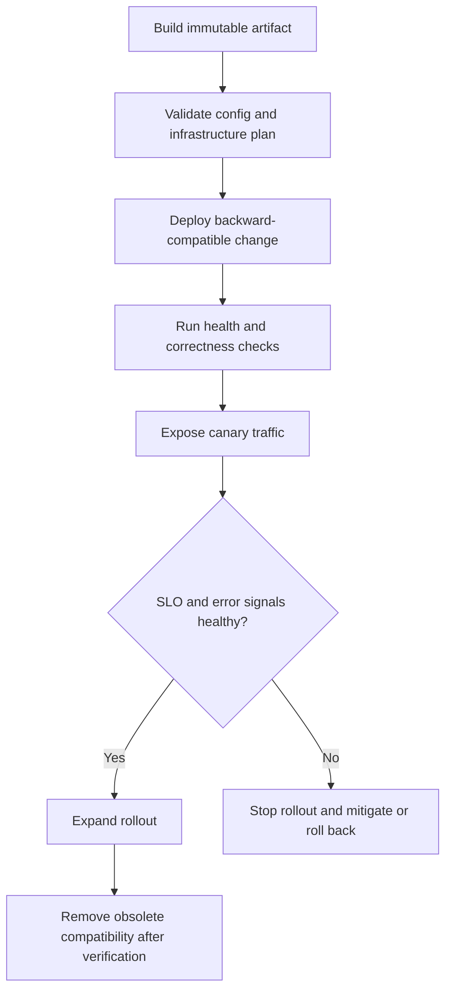

# 18. Cloud Infrastructure and Delivery

## Cloud primitives
Cloud service models are commonly described as IaaS, PaaS and SaaS, but provider boundaries vary. Architecturally, systems still need compute, network, identity, storage, observability and recovery. Managed services transfer some operational responsibilities to a provider; they do not remove the need to understand quotas, failure behavior, backups, regional dependencies or cost.

Regions and availability zones represent infrastructure failure domains, but their exact independence and connectivity are provider-specific. Deploying across zones helps only if traffic routing, state replication, capacity and failover behavior are designed accordingly.

## Containers and Kubernetes
Containers package a process with its dependencies and use operating-system isolation primitives; they are not virtual machines with a separate kernel in the usual container model. Kubernetes coordinates workloads through API objects and controllers. It can restart and reschedule containers, but it cannot make an application stateless, fix a broken database query, or guarantee that a replacement is instantly ready.

Resource requests influence scheduling; limits constrain resource use according to resource-specific behavior. CPU throttling can increase latency; memory limit breaches may terminate a container. Readiness, liveness and startup probes have different purposes. An overly aggressive liveness probe can turn a slow dependency into repeated restarts. See [Kubernetes architecture](https://kubernetes.io/docs/concepts/architecture/), [resource management](https://kubernetes.io/docs/concepts/configuration/manage-resources-containers/), and [probe guidance](https://kubernetes.io/docs/concepts/configuration/liveness-readiness-startup-probes/).

## Managed versus self-hosted
Managed services can reduce operational burden and provide integrated recovery features, but introduce provider-specific APIs, quotas, pricing and portability constraints. Self-hosting offers control but requires staffing, patching, upgrades, monitoring, backup, capacity planning and incident response. Compare total operational cost, not just service price.

## Infrastructure as code and configuration
Infrastructure as code makes desired infrastructure reviewable and repeatable. State drift, secrets, destructive plans and dependency ordering remain risks. Separate configuration from immutable artifacts, validate changes, use least-privilege deployment identities, and preserve rollback paths.

## Delivery strategies
- **Rolling deployment:** gradually replaces instances; old and new versions coexist.
- **Blue-green:** maintains two environments and switches traffic, requiring compatible data and capacity.
- **Canary:** exposes a small traffic cohort to a change and evaluates signals before expanding.
- **Feature flags:** decouple code deployment from behavior activation, but stale flags create complexity and security risk.

Rollback is not always a code-only operation. Database migrations, emitted events and external side effects may not be reversible. Design backward-compatible deployment steps and define what metrics stop rollout.

## Cost as a design dimension
Costs include compute, storage, data transfer, managed-service requests, replication, observability, backups, idle capacity and engineering operations. Cross-region transfer and chatty service boundaries can dominate. Optimize for cost per useful successful operation while preserving reliability and security objectives.

## Further reading
- Docker [container fundamentals](https://docs.docker.com/get-started/docker-concepts/the-basics/what-is-a-container/).
- Kubernetes [documentation](https://kubernetes.io/docs/home/).
- AWS [Well-Architected Framework](https://docs.aws.amazon.com/wellarchitected/latest/framework/welcome.html).

## Safe delivery through compatible states

Rollback can be unsafe if the new version has already changed data or emitted incompatible events. Prefer expand-and-contract migrations and make rollback criteria explicit before deployment.

---

[Back to textbook contents](../../README.md) · [Curriculum](../../CURRICULUM.md) · [Roadmap](../../ROADMAP.md)
