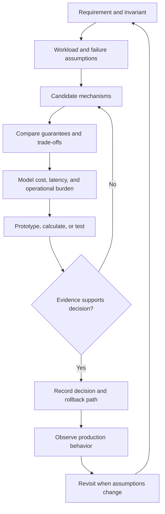

# 19. Advanced Cross-Cutting Reasoning

This final chapter connects mechanisms that are often taught separately but interact in production.

## Queueing and tail behavior
Little's Law relates average work in a stable system to arrival rate and average time: L = λW. It does not predict tail latency by itself. High utilization, bursty arrivals and variable service times can make waiting time rise nonlinearly. A queue buys time, not throughput; if arrivals persistently exceed service capacity, backlog grows without bound unless work is rejected, shed or capacity changes.

## Storage amplification and write paths
An LSM engine may reduce random in-place writes but create compaction work; a B-tree may maintain ordered pages but perform page splits and write amplification. Read, write and space amplification affect SSD endurance, latency and cost. The correct comparison uses realistic write sizes, update patterns, data sizes, cache state and read distributions rather than a single benchmark headline.

## Serialization and schema evolution
Serialization affects CPU, payload size, memory allocation, compatibility and observability. Schema evolution must account for producers and consumers deployed at different times. Additive fields can be compatible only if readers handle absent or unknown values safely. A field whose meaning changes is a breaking change even if its type remains identical.

## Probabilistic data structures
Bloom filters answer set-membership questions with possible false positives but no false negatives under standard assumptions and correct operation. A positive result means “possibly present,” not “definitely present.” They are useful when the cost of a false positive is an extra lookup and the cost of storing an exact set is high. Cardinality sketches and other approximate structures similarly trade exactness for bounded memory; their error properties and merge rules must be understood before use.

## Distributed scheduling
A distributed scheduler must consider ownership, duplicate execution, clock behavior, lease expiry, retries, missed runs and backfill. A scheduled job may run twice after a crash unless effects are idempotent or execution is coordinated. “Exactly once at the scheduled time” is generally not a realistic blanket guarantee; define whether the goal is at-least-once execution, at-most-once attempt, or one logical business effect.

## Multi-tenancy and noisy neighbors
Tenants share some combination of compute, connections, storage, caches, queues and control-plane resources. Isolation can be enforced through separate resources, quotas, workload pools, row-level policies or scheduling. Stronger isolation costs more; shared resources can be efficient but allow a noisy tenant to degrade others. Fairness policies need to define whether fairness means equal request count, CPU, latency or reserved capacity.

## Multi-region consistency and routing
Global traffic routing is only one part of multi-region architecture. Data placement, write ownership, replication lag, conflict resolution, regional failover, session guarantees and data residency all matter. DNS changes may not immediately affect existing connections or cached records. Active-active is not automatically more available if the write path requires global coordination or conflicting writes cannot be reconciled.

## Cost, complexity and evolution
A design should be evaluated on useful throughput, latency, correctness, availability, recovery, security, operating cost and change cost. A cheaper component can increase engineering burden; a managed service can reduce operational work while increasing provider dependence. Count failure modes and on-call complexity as real costs.

Prefer reversible decisions when uncertainty is high. Make irreversible or high-migration-cost choices only after validating the assumptions that drive them. Architecture should evolve from measured bottlenecks and changing requirements, not from novelty.

## Synthesis checklist
For any architectural decision, ask:
1. What requirement does it serve?
2. What workload and failure model are assumed?
3. What guarantee does it provide—and what does it not?
4. Where is the state of record?
5. What happens on timeout, duplicate, partition and recovery?
6. What is the effect on tail latency and overload?
7. How is correctness observed and tested?
8. What are the operational and financial costs?
9. How can the decision be rolled back or migrated?

## 19.1A Probabilistic structures: what the error means

A Bloom filter represents set membership compactly. Under its standard assumptions, a negative answer means the element is definitely absent from the represented set, while a positive answer means it may be present. False positives cause extra work; false negatives are not expected unless the filter is misused, corrupted, or updated under unsupported conditions.

The design trade-off depends on expected item count, memory budget, target false-positive rate, hash behavior, and update model. A Bloom filter does not store the original value or replace the authoritative lookup. It is useful when avoiding an expensive miss is worth the memory cost of a compact probabilistic summary.

Cardinality sketches estimate the number of distinct elements; quantile sketches estimate distribution summaries; count-min sketches estimate frequencies with overestimation error under their assumptions. Approximate structures should state error bounds, mergeability, update semantics, and acceptable decision risk.

## 19.1B Distributed scheduling and logical execution

Schedulers must define what happens when a job is delayed, missed, duplicated, retried, or running longer than its interval. A lease can coordinate ownership but does not alone prevent a stale worker from committing effects after lease expiry. Use idempotent effects, fencing/version checks, unique execution records, and explicit catch-up policy as appropriate.

Distinguish:
- **At-most-once attempt:** a scheduled occurrence is not retried after an uncertain attempt; work can be lost.
- **At-least-once attempt:** retries reduce loss but may execute more than once.
- **One logical effect:** duplicates are collapsed or made harmless through durable idempotency.

A scheduler can guarantee a dispatch policy under its own assumptions, but exactly one business effect requires the effect boundary to participate in deduplication or idempotency.

## 19.1C Multi-tenancy, fairness, and noisy neighbors

Tenant isolation is not just a security filter. Tenants compete for CPU, memory, threads, database connections, cache capacity, queue slots, storage I/O, and rate limits. A noisy tenant can degrade others without crossing a security boundary.

Fairness must be defined: equal request count, equal resource consumption, weighted service, reserved capacity, or latency guarantees are different goals. Per-tenant quotas, weighted queues, concurrency limits, separate pools, and storage partitioning can improve isolation, but each adds state and operational complexity. A global limiter can be unfair; a per-instance limiter can multiply with replica count.

Measure per-tenant demand using bounded labels or sampled logs rather than unbounded metrics that create cardinality explosions. Test both a single hot tenant and aggregate load from many tenants.

## 19.1D Multi-region behavior: serving is not consistency

Global routing directs clients to a region but does not decide which region owns a write or what a read must observe. A complete design states:
- Data placement and authoritative ownership.
- Replication mode and acknowledgment point.
- Read freshness and session guarantees.
- Conflict resolution for concurrent writers.
- Failover promotion and stale-writer fencing.
- Data residency constraints.
- Recovery point and recovery time.
- Behavior when regions cannot communicate.

Active-active serving can still use a single writer for each key or partition. Multi-writer writes require a conflict model that preserves business invariants. Active-passive failover can lose recent acknowledged changes if replication is asynchronous and the acknowledgment contract permits it. These are protocol decisions, not consequences of the topology label.

## 19.1E Cost and complexity as first-class design variables

A useful cost model includes infrastructure, data transfer, storage and replication, managed-service operations, observability, backups, idle headroom, incident response, and engineering effort. Optimize for cost per successful useful operation rather than raw request count; rejected or incorrect requests are not useful throughput.

Complexity creates indirect costs: more failure modes, more dashboards, more deployment coordination, more runbooks, and more expertise required during incidents. A managed service can reduce operational burden while increasing provider dependence. A custom service can improve control while creating an ongoing maintenance obligation.

## 19.1F Architecture review through explicit evidence

For every consequential decision, connect:
- Requirement and business invariant.
- Workload and failure assumptions.
- Mechanism and exact guarantee.
- Alternatives and rejected trade-offs.
- Test or measurement that could falsify the design.
- Operational owner and recovery procedure.
- Rollback, migration, or revisit trigger.

Prefer a prototype or load/failure test when the decision depends on uncertain performance. Prefer a proof, documented protocol guarantee, or invariant test when correctness is the central risk. Benchmarks cannot prove distributed correctness; formal reasoning cannot establish production capacity without measurements. Use the right evidence for the claim.

## Further reading
- O'Neil et al., [LSM-tree paper](https://doi.org/10.1007/s002360050048).
- Google SRE [Handling Overload](https://sre.google/sre-book/handling-overload/).
- [Raft resources](https://raft.github.io/) for replicated coordination.

## An architecture decision review loop

The best architecture is not the one with the most patterns. It is the simplest design that satisfies the actual invariants and service objectives under the expected workload and failure model.

---

[Back to textbook contents](../../README.md) · [Curriculum](../../CURRICULUM.md) · [Roadmap](../../ROADMAP.md)
