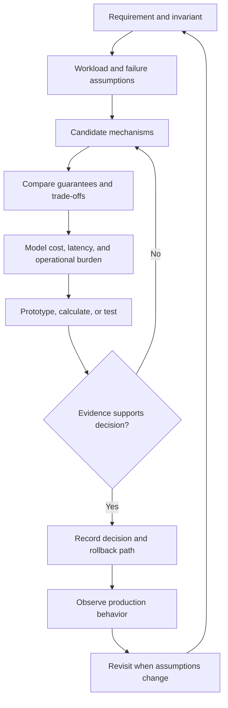

# 19. Advanced Cross-Cutting Reasoning

This final chapter connects mechanisms that are often taught separately but interact in production.

## Queueing and tail behavior
Little's Law relates average work in a stable system to arrival rate and average time: L = λW. It does not predict tail latency by itself. High utilization, bursty arrivals and variable service times can make waiting time rise nonlinearly. A queue buys time, not throughput; if arrivals persistently exceed service capacity, backlog grows without bound unless work is rejected, shed or capacity changes.

## Storage amplification and write paths
An LSM engine may reduce random in-place writes but create compaction work; a B-tree may maintain ordered pages but perform page splits and write amplification. Read, write and space amplification affect SSD endurance, latency and cost. The correct comparison uses realistic write sizes, update patterns, data sizes, cache state and read distributions rather than a single benchmark headline.

## Serialization and schema evolution
Serialization affects CPU, payload size, memory allocation, compatibility and observability. Schema evolution must account for producers and consumers deployed at different times. Additive fields can be compatible only if readers handle absent or unknown values safely. A field whose meaning changes is a breaking change even if its type remains identical.

## Probabilistic data structures
Bloom filters answer set-membership questions with possible false positives but no false negatives under standard assumptions and correct operation. A positive result means “possibly present,” not “definitely present.” They are useful when the cost of a false positive is an extra lookup and the cost of storing an exact set is high. Cardinality sketches and other approximate structures similarly trade exactness for bounded memory; their error properties and merge rules must be understood before use.

## Distributed scheduling
A distributed scheduler must consider ownership, duplicate execution, clock behavior, lease expiry, retries, missed runs and backfill. A scheduled job may run twice after a crash unless effects are idempotent or execution is coordinated. “Exactly once at the scheduled time” is generally not a realistic blanket guarantee; define whether the goal is at-least-once execution, at-most-once attempt, or one logical business effect.

## Multi-tenancy and noisy neighbors
Tenants share some combination of compute, connections, storage, caches, queues and control-plane resources. Isolation can be enforced through separate resources, quotas, workload pools, row-level policies or scheduling. Stronger isolation costs more; shared resources can be efficient but allow a noisy tenant to degrade others. Fairness policies need to define whether fairness means equal request count, CPU, latency or reserved capacity.

## Multi-region consistency and routing
Global traffic routing is only one part of multi-region architecture. Data placement, write ownership, replication lag, conflict resolution, regional failover, session guarantees and data residency all matter. DNS changes may not immediately affect existing connections or cached records. Active-active is not automatically more available if the write path requires global coordination or conflicting writes cannot be reconciled.

## Cost, complexity and evolution
A design should be evaluated on useful throughput, latency, correctness, availability, recovery, security, operating cost and change cost. A cheaper component can increase engineering burden; a managed service can reduce operational work while increasing provider dependence. Count failure modes and on-call complexity as real costs.

Prefer reversible decisions when uncertainty is high. Make irreversible or high-migration-cost choices only after validating the assumptions that drive them. Architecture should evolve from measured bottlenecks and changing requirements, not from novelty.

## Synthesis checklist
For any architectural decision, ask:
1. What requirement does it serve?
2. What workload and failure model are assumed?
3. What guarantee does it provide—and what does it not?
4. Where is the state of record?
5. What happens on timeout, duplicate, partition and recovery?
6. What is the effect on tail latency and overload?
7. How is correctness observed and tested?
8. What are the operational and financial costs?
9. How can the decision be rolled back or migrated?

## 19.1A Probabilistic structures: what the error means

A Bloom filter represents set membership compactly. Under its standard assumptions, a negative answer means the element is definitely absent from the represented set, while a positive answer means it may be present. False positives cause extra work; false negatives are not expected unless the filter is misused, corrupted, or updated under unsupported conditions.

The design trade-off depends on expected item count, memory budget, target false-positive rate, hash behavior, and update model. A Bloom filter does not store the original value or replace the authoritative lookup. It is useful when avoiding an expensive miss is worth the memory cost of a compact probabilistic summary.

Cardinality sketches estimate the number of distinct elements; quantile sketches estimate distribution summaries; count-min sketches estimate frequencies with overestimation error under their assumptions. Approximate structures should state error bounds, mergeability, update semantics, and acceptable decision risk.

### Bloom filter sizing: a worked approximation

For a standard Bloom filter with m bits, n inserted items and k hash functions, the approximate false-positive probability under the usual uniform-hash assumptions is:

`p ≈ (1 − e^(−kn/m))^k`

The near-optimal number of hash functions for a chosen m and n is:

`k ≈ (m/n) ln 2`

Solving for a target false-positive probability p gives the common sizing approximation:

`m ≈ −n ln(p) / (ln 2)^2`

Example: to represent about one million items with a target false-positive rate near 1%:

- n = 1,000,000 and p = 0.01.
- m ≈ −1,000,000 × ln(0.01) / (ln 2)^2 ≈ 9.59 million bits.
- Raw bit storage ≈ 9.59 million / 8 ≈ 1.20 MB decimal, or about 1.14 MiB.
- k ≈ (m/n) × ln 2 ≈ 6.64, so about 7 hash functions is a practical integer choice.

This is a planning approximation, not a guarantee that a concrete implementation will achieve exactly 1% false positives. Hash quality, implementation details, capacity overshoot and the actual inserted-item count affect the observed rate. Monitor occupancy and rebuild or resize before the filter becomes overfull.

A standard Bloom filter does not support safe arbitrary deletion because clearing a bit may cause false negatives for another item that set the same bit. Counting Bloom filters or rebuilding are alternatives, each with additional memory or operational cost. Bloom filters should reduce expensive authoritative lookups, not replace the source of truth.

## 19.1B Distributed scheduling and logical execution

Schedulers must define what happens when a job is delayed, missed, duplicated, retried, or running longer than its interval. A lease can coordinate ownership but does not alone prevent a stale worker from committing effects after lease expiry. Use idempotent effects, fencing/version checks, unique execution records, and explicit catch-up policy as appropriate.

Distinguish:
- **At-most-once attempt:** a scheduled occurrence is not retried after an uncertain attempt; work can be lost.
- **At-least-once attempt:** retries reduce loss but may execute more than once.
- **One logical effect:** duplicates are collapsed or made harmless through durable idempotency.

A scheduler can guarantee a dispatch policy under its own assumptions, but exactly one business effect requires the effect boundary to participate in deduplication or idempotency.

## 19.1C Multi-tenancy, fairness, and noisy neighbors

Tenant isolation is not just a security filter. Tenants compete for CPU, memory, threads, database connections, cache capacity, queue slots, storage I/O, and rate limits. A noisy tenant can degrade others without crossing a security boundary.

Fairness must be defined: equal request count, equal resource consumption, weighted service, reserved capacity, or latency guarantees are different goals. Per-tenant quotas, weighted queues, concurrency limits, separate pools, and storage partitioning can improve isolation, but each adds state and operational complexity. A global limiter can be unfair; a per-instance limiter can multiply with replica count.

Measure per-tenant demand using bounded labels or sampled logs rather than unbounded metrics that create cardinality explosions. Test both a single hot tenant and aggregate load from many tenants.

## 19.1D Multi-region behavior: serving is not consistency

Global routing directs clients to a region but does not decide which region owns a write or what a read must observe. A complete design states:
- Data placement and authoritative ownership.
- Replication mode and acknowledgment point.
- Read freshness and session guarantees.
- Conflict resolution for concurrent writers.
- Failover promotion and stale-writer fencing.
- Data residency constraints.
- Recovery point and recovery time.
- Behavior when regions cannot communicate.

Active-active serving can still use a single writer for each key or partition. Multi-writer writes require a conflict model that preserves business invariants. Active-passive failover can lose recent acknowledged changes if replication is asynchronous and the acknowledgment contract permits it. These are protocol decisions, not consequences of the topology label.

## 19.1E Cost and complexity as first-class design variables

A useful cost model includes infrastructure, data transfer, storage and replication, managed-service operations, observability, backups, idle headroom, incident response, and engineering effort. Optimize for cost per successful useful operation rather than raw request count; rejected or incorrect requests are not useful throughput.

Complexity creates indirect costs: more failure modes, more dashboards, more deployment coordination, more runbooks, and more expertise required during incidents. A managed service can reduce operational burden while increasing provider dependence. A custom service can improve control while creating an ongoing maintenance obligation.

## 19.1F Architecture review through explicit evidence

For every consequential decision, connect:
- Requirement and business invariant.
- Workload and failure assumptions.
- Mechanism and exact guarantee.
- Alternatives and rejected trade-offs.
- Test or measurement that could falsify the design.
- Operational owner and recovery procedure.
- Rollback, migration, or revisit trigger.

Prefer a prototype or load/failure test when the decision depends on uncertain performance. Prefer a proof, documented protocol guarantee, or invariant test when correctness is the central risk. Benchmarks cannot prove distributed correctness; formal reasoning cannot establish production capacity without measurements. Use the right evidence for the claim.

## 19.2 Architecture pattern catalog: context and consequences

A pattern is a reusable response to a recurring design problem. It is not a universally correct component. Before adopting a pattern, identify the force it addresses, the new failure modes it introduces, and the invariant it must preserve.

### Strangler pattern

The strangler pattern gradually routes selected capabilities from a legacy system to a replacement. It reduces the risk of a one-time rewrite but requires routing control, data ownership, compatibility, observability and a clear retirement plan. During migration, both systems may be live; writes and reads must have an explicit source of truth to avoid divergent state.

### Anti-corruption layer

An anti-corruption layer translates an external or legacy model into the domain's own model. It protects internal concepts from leaking vendor-specific fields and semantics. It should make translation explicit and observable; a layer that silently drops fields or hides incompatible meaning can create data corruption that is hard to diagnose.

### Sidecar and ambassador

A sidecar runs alongside an application to provide a capability such as proxying, telemetry or certificate handling. An ambassador pattern commonly places a proxy in front of a remote service to simplify access or connectivity. Both can standardize cross-cutting behavior, but they add another process, configuration surface, resource consumer and failure mode. Decide whether the added hop and control plane are worth the consistency they provide.

### Competing consumers and work queues

Multiple workers compete to process items from a shared queue or subscription. This improves throughput when tasks are independent, but requires idempotency, visibility/lease expiry behavior, poison-message handling and a bounded retry policy. If task completion can outlive the lease, two workers may process the same task; fencing or idempotent effects may be needed.

### Fan-out/fan-in

A request fans out to parallel subrequests and combines results. Latency is often dominated by the slowest required branch, and each branch consumes concurrency and downstream capacity. Bound fan-out width, use a shared deadline, define partial-result behavior, and avoid retrying every branch indiscriminately. A request that fans out to 100 dependencies can amplify traffic dramatically even if the incoming request rate is modest.

### Claim check

When a message payload is too large or sensitive to copy through a broker, publish a small claim-check message containing a reference to the payload in durable storage. This reduces broker payload pressure but introduces a lifecycle dependency: the referenced object must remain available and authorized for as long as the message may be processed or replayed. Define cleanup, encryption, access control and missing-object recovery.

### Materialized view

A materialized view stores a precomputed representation optimized for a read path. It reduces read cost at the expense of storage, update work and freshness. Define the authoritative source, update mechanism, acceptable lag, rebuild procedure and how readers detect stale or incomplete projections.

### Scheduler and lease-based work ownership

A distributed scheduler assigns due work across workers. Correctness requires clear ownership, clock assumptions, lease expiry, duplicate execution behavior, retry policy, and a strategy for tasks that run longer than their lease. A lease does not stop a paused old worker from acting after expiry; fencing tokens or idempotent effects may be required at the resource boundary.

### Bulkhead, circuit breaker and retry budget

A bulkhead isolates resource pools or concurrency budgets so one dependency or workload cannot consume everything. A circuit breaker suppresses calls when a dependency is failing, allowing recovery or a fallback. A retry budget limits extra attempts so recovery traffic does not dominate original work. These patterns complement each other but are not substitutes: isolation protects capacity, a breaker changes call admission, and a retry budget bounds amplification.

### CQRS, event sourcing and saga: avoid pattern bundles

CQRS separates command and query models; event sourcing makes an event history authoritative; a saga coordinates a business process across multiple local transactions with compensations or forward recovery. They solve different problems and can be combined, but each adds operational cost. CQRS adds projection freshness, event sourcing adds schema/replay/retention complexity, and sagas add workflow state, timeouts, duplicate handling and compensation semantics.

### Common anti-patterns

- **Distributed monolith:** services deploy separately but require synchronized changes and chatty calls to complete one invariant.
- **God gateway:** business logic and orchestration accumulate in a shared entry point.
- **Retry everything:** retries amplify overload and repeat unsafe operations.
- **Unbounded queue:** hides overload until latency, memory or disk becomes catastrophic.
- **Shared database as integration API:** independent services couple to one schema and can violate each other's assumptions.
- **Cache as source of truth:** eviction or loss changes correctness unexpectedly.
- **Global synchronous dependency:** a noncritical remote service becomes required for every user action.
- **Exactly-once by slogan:** a local broker guarantee is mistaken for an end-to-end business guarantee.
- **Replica-count theater:** multiple replicas share the same failure domain or authoritative bottleneck.
- **Big-bang rewrite:** migration risk is concentrated into one release without staged compatibility or rollback.

### Pattern selection checklist

- What specific problem and force is the pattern addressing?
- Which invariant or guarantee must remain true?
- What new state, component, network hop or failure mode does it add?
- Does it improve ownership, latency, throughput, reliability or changeability measurably?
- What is the operational and cost overhead?
- How are duplicates, retries, replay, stale state and partial failure handled?
- What observable evidence would show the pattern is working?
- Can a simpler design meet the requirement?
- What is the migration and rollback path?

## 19.3 Worked multi-tenant fairness scenario

Assume a shared API serves three tenants. Tenant A runs a bursty batch integration, while tenants B and C serve interactive users. The service has four replicas and a shared database. A single global request-rate limit may let A consume most of the budget; a separate per-process limit may accidentally multiply the intended tenant allowance by the replica count.

### Define what fairness means

Fairness is not one universal metric. For this service, assume the policy is:

- Preserve a minimum share of capacity for interactive tenants B and C during A's batch bursts.
- Permit A to use spare capacity when it does not harm the interactive latency objective.
- Bound total database concurrency across all four replicas.
- Apply the same authorization and data-isolation rules regardless of which tenant receives capacity.

### Why a per-instance rate limit can mislead

If each of four replicas independently allows tenant A 100 requests/s, the effective allowance may approach 400 requests/s when traffic spreads across all replicas. Conversely, a single shared limit can be accurate but adds coordination latency and becomes another dependency. The implementation must state whether the limit is per process, per tenant globally, per route, or per resource cost.

### A candidate policy

1. **Bound the scarce resource first.** Set a total database concurrency ceiling based on tested database capacity, leaving room for administration and recovery operations.
2. **Reserve critical capacity.** Use separate pools or weighted concurrency budgets so a burst from A cannot consume every slot needed by interactive work.
3. **Add tenant-aware admission.** Enforce per-tenant sustained rates, burst allowances and in-flight limits. If limits are distributed, define how replicas coordinate and what temporary overrun is acceptable during a partition.
4. **Use cost-aware limits where needed.** One expensive export may consume far more CPU, I/O or database time than one cached read; request count alone may not represent resource fairness.
5. **Reject or defer predictably.** Return an explicit retryable response or queue batch work within a bounded durable backlog. Do not let clients retry immediately without jitter and a shared deadline.
6. **Observe fairness and isolation separately.** Measure per-tenant admitted/rejected work, latency, resource consumption and queue age using bounded labels or controlled logs. Keep authorization tests separate from resource-fairness tests.

### Validate the policy with a noisy-neighbor test

Run a representative baseline with all three tenants, then raise A's offered load sharply while B and C continue their interactive workload. Verify that B and C remain within their agreed latency/error objectives, the database concurrency ceiling holds, A's excess work is rejected or delayed according to policy, and spare capacity can be used when available. Repeat with uneven traffic across replicas and during a replica loss to expose local-limit multiplication and failover effects.

### Review checklist

- [ ] Is fairness defined as request count, resource share, priority, reserved capacity or latency objective?
- [ ] Do per-instance limits multiply with replica count, and is that acceptable?
- [ ] Can one tenant exhaust shared database connections, queue slots, cache or worker pools?
- [ ] Are batch and interactive work isolated or weighted appropriately?
- [ ] Are quotas and overload responses safe during retries and partial coordination failure?
- [ ] Are noisy-neighbor tests run both in healthy topology and after replica/zone loss?
- [ ] Are per-tenant metrics useful without creating unbounded metric cardinality?
- [ ] Are security isolation and resource fairness tested as separate properties?
## 19.4 Pattern interactions: combinations can amplify failure

Architecture patterns rarely operate alone. A retry policy changes the load seen by a circuit breaker; autoscaling changes the aggregate connection budget; caching changes freshness and authorization behavior; asynchronous replication changes disaster-recovery guarantees. Review the combined system rather than approving each pattern in isolation.

| Pattern combination | Interaction or failure risk | Design rule |
|---|---|---|
| Retries + hedged requests | Both create additional attempts; together they can multiply work during a slow dependency incident | Count every attempt in the budget, restrict hedging to safe operations, and avoid stacking independent retry policies at multiple layers |
| Retries + circuit breaker + bulkhead | Retries can consume isolated capacity; breakers can open broadly; recovery probes can synchronize | Use bounded retries/deadlines, per-dependency concurrency isolation, controlled half-open probes and a clear fallback contract |
| Autoscaling + database connection pools | More application replicas multiply local pool sizes and can overload a database that does not scale at the same rate | Budget aggregate connections across maximum replicas and reserve capacity for operations/recovery |
| Cache + read replica | Cache staleness and replica lag can compound; a cache refill may store an already stale value | Define a freshness contract, use versions or authoritative reads when required, and prevent stale fills from overwriting newer values |
| Cache + authorization/tenant isolation | A response can be served to the wrong tenant or remain available after permission revocation | Include all response-varying authorization scope in the policy/key, enforce access rules on cache hits, and test revocation/deletion paths |
| Outbox + at-least-once broker delivery | Outbox publication and consumer delivery may both repeat after uncertain acknowledgements | Use stable event IDs, idempotent publication/progress handling and consumer inbox/deduplication where effects require it |
| Async replication + regional failover | A promoted replica may lack recently acknowledged writes; the former primary may still accept writes | State the RPO/acknowledgement contract, fence the old writer, reconcile divergence and test failover/failback |
| Service mesh retries + application retries | Two layers may retry the same request, multiply attempts and obscure the actual deadline | Assign retry ownership deliberately, propagate a shared deadline, and inspect effective attempts across all layers |
| Load shedding + autoscaling | Shedding may hide demand from autoscalers; autoscaling may arrive too late to prevent queue growth | Scale from a suitable offered-load/saturation signal and keep bounded queues and explicit rejection behavior |
| Event replay + external side effects | Rebuilding a projection may resend emails, trigger payments or repeat other irreversible actions | Separate pure projection rebuilds from effectful workflows; use idempotency keys and explicit replay modes |

### Interaction review procedure

1. Identify the primary pattern and every neighboring policy that can change its input, output, timing or resource use.
2. Draw the combined request/event path, including retries, queues, caches, replicas and external effects.
3. Calculate aggregate limits across replicas and layers; local limits are not automatically global limits.
4. Trace crash, timeout, restart, partition and recovery cases—not just the healthy path.
5. State which component owns each guarantee and which telemetry proves it is being met.
6. Test at least one combined failure where two mechanisms interact, such as replica loss during retry traffic or permission revocation during cache refill.

### Cross-pattern review checklist

- [ ] Do retries, hedges and redelivery share a bounded work budget?
- [ ] Can scaling multiply downstream connections, queue consumers or provider requests beyond capacity?
- [ ] Can cache and replica staleness compound beyond the permitted freshness window?
- [ ] Are authorization, revocation and deletion guarantees preserved across derived copies?
- [ ] Are durable progress markers atomic with the effects they represent?
- [ ] Are old leaders/writers fenced during failover and recovery?
- [ ] Can an operational mitigation create a second failure, such as a retry storm or connection storm?
- [ ] Does the test plan cover combinations of mechanisms as well as each mechanism individually?

## An architecture decision review loop

The best architecture is not the one with the most patterns. It is the simplest design that satisfies the actual invariants and service objectives under the expected workload and failure model.

## Further reading
- O'Neil et al., [LSM-tree paper](https://doi.org/10.1007/s002360050048).
- Google SRE [Handling Overload](https://sre.google/sre-book/handling-overload/).
- [Raft resources](https://raft.github.io/) for replicated coordination.

---

[Back to textbook contents](../../README.md) · [Curriculum](../../CURRICULUM.md) · [Roadmap](../../ROADMAP.md)
