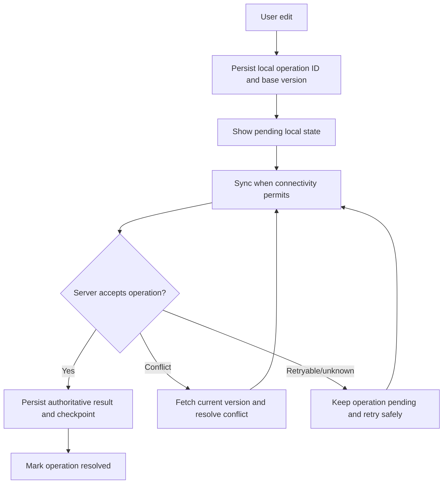
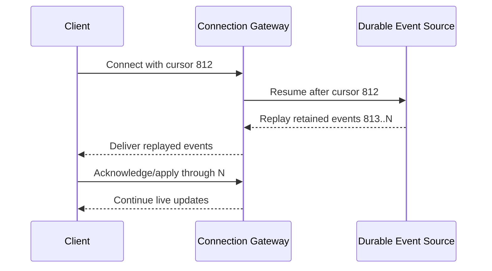

# 20. Client-Side, Offline-First, and Real-Time Architecture

Client-side architecture is part of system design whenever user devices render application state, continue working through unreliable connectivity, synchronize changes, or exchange low-latency updates. A backend can be internally correct and highly available while the product still fails because the client displays stale state, loses offline edits, reconnects in a thundering herd, or treats an untrusted client as authoritative.

This chapter develops the underlying mechanisms rather than prescribing a particular frontend framework. It covers rendering and delivery choices, client/server state boundaries, offline-first behavior, synchronization and conflict resolution, real-time transports, peer-to-peer media, collaborative state, micro-frontends, and operational failure modes. These are reusable architectural concepts, not a complete end-to-end design case study.

## 20.1 Establish the client/server responsibility boundary

A client may run in a browser, mobile application, desktop application, embedded device, or game runtime. Its environment differs from a server: it may be suspended, restarted, disconnected, modified by the user, run on old versions, or have limited CPU, memory, battery, storage, and network bandwidth.

Separate three categories of state:

- **Authoritative state:** the source of truth for business rules and shared facts. It usually belongs on a trusted server or durable service.
- **Client-local state:** transient UI state such as open panels, unsent text, scroll position, and temporary selections.
- **Replicated or cached state:** a client-side copy of server-owned data used to reduce latency or support offline work. It needs a freshness and reconciliation policy.

A client can optimistically display a proposed change before the server confirms it, but the interface must represent pending, accepted, rejected, and unknown outcomes distinctly. An optimistic UI is a presentation technique, not a consistency guarantee.

### Define ownership per operation

For each operation, specify:
1. Who is allowed to propose the change?
2. Which component validates authorization and business invariants?
3. Where does the authoritative commit occur?
4. What acknowledgement means success?
5. How does the client recover after a timeout, restart, or reconnect?
6. Can the operation be retried, and what makes retries safe?

Never rely on a client-only check for a security-sensitive or globally shared invariant. A modified client can skip validation, change payloads, replay requests, or claim a result it did not obtain from the authoritative service.

## 20.2 Rendering and application delivery choices

Rendering strategy affects time to useful content, interaction readiness, server cost, caching, personalization, and deployment complexity. These approaches can be combined; they are not mutually exclusive religions.

| Approach | Where initial UI is produced | Strengths | Costs and failure modes |
|---|---|---|---|
| Client-side rendering (CSR) | Browser downloads application code and renders from data | Rich interaction; clear client runtime | Initial code/data transfer can delay useful content; JavaScript failure or slow devices can block rendering |
| Server-side rendering (SSR) | Server renders HTML for a request | Faster initial content in many cases; useful for content discovery | Server compute and caching complexity; hydration must match the rendered state |
| Static site generation (SSG) | HTML is generated ahead of requests | Efficient delivery and strong cacheability | Freshness and personalization require explicit handling; rebuilds can be expensive |
| Incremental or revalidated static output | Previously generated output is refreshed on a policy | Balances cache efficiency and bounded freshness | Revalidation races and stale output must be understood |
| Streaming or progressive rendering | Parts of the response are delivered as they become available | Earlier display of useful sections | Partial UI states, error handling and ordering become more complex |
| Hybrid rendering | Different routes or components use different strategies | Matches delivery to content and interaction needs | More deployment paths, cache policies and debugging dimensions |

### Hydration and duplicate work

With server rendering plus client hydration, the browser attaches behavior to server-produced markup. The server and client must agree on the initial data and rendering assumptions. If they diverge, the result can be mismatched markup, visible flicker, duplicated requests, or discarded client state.

A sound design states:
- Which content can be cached publicly and which is personalized.
- How the initial data snapshot is transferred to the client.
- Whether client startup repeats requests already completed on the server.
- How errors during hydration or partial rendering are surfaced.
- Which routes remain useful when client-side code fails.
- How assets and HTML are versioned so a cached page does not reference deleted or incompatible bundles.

### Cache correctness at the edge and in the browser

HTML, scripts, API responses, images and media have different freshness and security requirements. A public immutable JavaScript asset can often use a content-hashed filename and long-lived caching; personalized HTML or authorization-dependent data must not accidentally enter a shared cache.

Cache keys and variation rules must reflect every response-changing input that the caching layer is permitted to consider. Never assume a CDN automatically understands application identity or authorization. Verify cache behavior for cookies, authorization headers, locale, device variants and other relevant dimensions. Sensitive responses should have an explicit policy, and invalidation must cover all copies that can expose old data.

## 20.3 Client state, server state and optimistic updates

A client interface often combines:
- **Server state:** data fetched from an authoritative service.
- **Local interaction state:** selection, focus, open dialogs and drafts.
- **Pending mutations:** commands sent but not yet confirmed.
- **Derived state:** values computed from other state.
- **Persisted local state:** preferences, drafts, or offline records that survive a restart.

Keeping these categories distinct prevents a common bug: treating a locally displayed optimistic value as if it were a committed server fact.

### A robust mutation lifecycle

A useful state model is:

`idle → pending → confirmed`

with explicit alternate outcomes:

`pending → rejected` or `pending → outcome unknown`

- **Pending:** the client has submitted the operation but lacks a definitive result.
- **Confirmed:** the authoritative service has acknowledged the operation under its documented commit contract.
- **Rejected:** the service has definitively rejected the operation.
- **Outcome unknown:** the connection failed or timed out without establishing whether the operation committed.

For an unknown outcome, do not blindly reverse the UI or issue a new logical operation. Query operation status or retry using the same durable idempotency identity when the API supports it. A timeout does not prove the server rolled back.

When multiple mutations affect the same entity, define ordering. A later local edit can race with an earlier request's response; attach operation IDs or versions so an old response cannot overwrite newer client intent.

## 20.4 Offline-first design

Offline-first systems treat disconnection as a normal operating condition rather than an exceptional dialog. They are useful for field work, mobile applications, document editing, and environments with intermittent networks. They also introduce explicit synchronization, conflict, retention and security responsibilities.

### The local write path

A common pattern is to persist a local operation before presenting it as safely queued:

1. Validate what can be validated locally without pretending local checks replace server authorization.
2. Write the operation and its stable identifier to durable local storage.
3. Update the local view as pending.
4. Attempt synchronization when connectivity and policy permit.
5. Send operations with an idempotency identity and, when relevant, the base version observed by the client.
6. Persist the authoritative result or conflict response.
7. Mark the operation resolved only after the outcome is durable locally.

If the application acknowledges “saved offline,” it should mean the local operation survived the failure modes promised by the product, such as a tab reload or application restart. It does not mean the server has accepted the change.

### Local durability and storage limits

Browser storage may be quota-limited, evicted, cleared by the user, or unavailable in private/restricted contexts. Mobile and desktop stores also have platform-specific durability and backup semantics. State what can be lost, how the user can export or recover important work, and how storage-full errors are handled.

Do not store secrets or sensitive data locally without a deliberate threat model. Device loss, shared devices, browser extensions, local malware, backups and synchronization can expand the exposure boundary. Apply least privilege, appropriate encryption, retention limits, and logout/account-switch cleanup. Encryption at rest does not protect data from a compromised application runtime that can decrypt it.

### The outbox pattern on the client

A local operation log resembles an outbox: user intent is durably recorded first, then delivered asynchronously. The delivery can repeat after a crash, so the server must recognize duplicate logical operations. Client-side deduplication alone is insufficient because storage may be reset or the same action may be submitted from another device.

Each queued operation should have enough information to define its meaning, for example:
- Stable operation ID.
- Target entity and operation type.
- Payload or payload reference.
- Base version or precondition, if needed.
- Creation time for user-facing diagnostics, not as the sole conflict-ordering authority.
- Retry and resolution state.
- Schema/version information for upgrades.

Queue migration matters: an application update may change the meaning of an old queued operation. Define compatibility, migration, quarantine and user-recovery behavior for operations that can no longer be interpreted safely.

## 20.5 Synchronization and conflict resolution

Synchronization is not simply “upload local changes.” It is a protocol that must define identity, ordering, retries, versioning, deletion, conflict policy, and recovery after partial progress.

### Common conflict strategies

| Strategy | Appropriate when | Main risk |
|---|---|---|
| Last-write-wins (LWW) | A single scalar preference where losing one concurrent value is acceptable | Wall-clock timestamps can be skewed; one user's update can silently erase another's |
| Optimistic concurrency with version/ETag | Conflicts should be detected and resolved by the user or domain logic | Clients must handle conflict responses and refresh/rebase |
| Server-authoritative merge | The domain has a clear owner and deterministic validation rules | The server must define which operations can be combined and how rejected changes are explained |
| Field-level merge | Independent fields can change safely without violating cross-field invariants | Field independence is often assumed incorrectly |
| Operation-based merge | Operations have stable identities and can be replayed or transformed | Requires a well-defined operation algebra and duplicate handling |
| CRDT-based merge | The data type and operations have convergence properties suitable for the product | Convergence does not automatically preserve every business invariant or user expectation |
| Manual conflict resolution | The cost of silent loss is high and concurrent edits are uncommon enough to surface | Adds UX and workflow complexity |

A merge rule must preserve domain invariants, not just produce a deterministic value. For example, independently merging two account fields may create an invalid combination, and merging financial balances by taking the latest value is not an accounting model.

### Version-based conditional updates

An entity can expose a version or ETag. A client submits its mutation only if the server's current version still matches the version it read. If it does not match, the server rejects the conditional update (often with a precondition-failed or conflict response, according to the API contract). The client fetches the current state, compares changes, and retries only after re-evaluating the domain rule.

This prevents silent overwrites when the condition is enforced atomically at the authoritative resource. A version check performed separately from the update has a race window.

### Deletion and tombstones

Deleting an item while another device is offline creates a special conflict: the offline device may later upload an old copy and accidentally resurrect it. A tombstone or versioned deletion marker can communicate deletion to replicas until the system can safely compact it. Tombstone retention must account for the longest supported offline interval, backup restoration and delayed clients; premature cleanup can allow stale replicas to resurrect deleted data.

Define how deletion propagates through search indexes, caches, exports, local replicas and backups, and whether legal retention requirements affect permanent erasure.

The checkpoint must advance only after the corresponding changes are durably applied locally. If a conflict is unresolved, keep enough information to explain the state to the user rather than silently discarding the operation.

### Ordering and checkpoints

A synchronization checkpoint must mean something precise: all changes up to a particular server-defined sequence or cursor have been applied, or all local operations up to a defined position have been acknowledged. Avoid relying on client wall-clock time as a globally reliable ordering mechanism.

For paginated change feeds, define stable cursors, retention expiry, duplicate handling and behavior when a client falls too far behind. If a cursor expires, a full resynchronization may be required. The client should not advance its checkpoint past changes it has not durably applied.

## 20.6 Real-time update transports

“Real time” is a latency objective, not a protocol. Select a transport based on directionality, connection lifetime, ordering, reliability, browser support, proxy behavior, scale and operational cost.

| Mechanism | Communication shape | Useful for | Important limits |
|---|---|---|---|
| Short polling | Client periodically requests changes | Simple low-frequency refresh | Adds repeated request overhead and update delay |
| Long polling | Server holds a request until data or timeout | Near-real-time server-to-client updates without a continuously bidirectional protocol | Reconnect churn, held request resources and proxy timeouts |
| Server-Sent Events (SSE) | Persistent server-to-client event stream over HTTP | Feeds, progress, notifications, live status | One-way; client-to-server commands use another path; reconnect and event IDs need policy |
| WebSocket | Persistent bidirectional messages | Chat, interactive updates, collaborative presence | Connection management, fan-out, backpressure and reconnect recovery are application responsibilities |
| WebRTC data channels | Peer-to-peer data after connection setup | Low-latency interactive peer communication | NAT traversal, signaling, peer connectivity, encryption and relay fallback add complexity |
| WebRTC media tracks | Real-time audio/video media | Calls, conferencing and interactive media | Bandwidth adaptation, jitter, packet loss, TURN relay cost and media topology matter |
| WebTransport | Modern HTTP/3-based transport with stream/datagram capabilities where supported | Selected low-latency browser use cases | Deployment, browser, intermediary and infrastructure support must be verified |

### A persistent connection is not durable delivery

A WebSocket or SSE connection tells the client that a transport path exists now. It does not guarantee that a disconnected client receives every event. If missing an event matters, define:
- A durable event source or change feed.
- A cursor/sequence identifier and retention window.
- Reconnect and replay behavior.
- Duplicate delivery semantics.
- A snapshot/resynchronization path when history has expired.
- Backpressure and slow-consumer policy.

For example, a live dashboard can tolerate coalescing intermediate values if it can fetch a current snapshot. An audit or financial workflow generally cannot treat a transient socket as its only durable record.

### Connection lifecycle and fan-out

Persistent connections consume memory, file descriptors, buffers, heartbeat work and routing state. Capacity planning must estimate active connections, messages per second, average and tail message sizes, fan-out recipients, reconnect rate and slow-consumer behavior—not just HTTP request rate.

A reconnect storm after a regional interruption can overload authentication, connection admission and subscription recovery. Use exponential backoff with jitter, bounded retries, connection limits, resume cursors and staged recovery. Heartbeats detect some dead paths but consume resources and do not prove application-level processing.

A connection-serving tier may be separated from business services, but the design then needs subscription ownership, routing between nodes, presence expiration, authorization, and recovery when a connection node fails. Avoid treating an in-memory subscription map as durable truth unless losing it is explicitly acceptable.

The sequence is illustrative: the actual acknowledgement and cursor protocol must define when the client has durably applied an event. If the cursor has expired, the server should require a snapshot or full resynchronization rather than pretending the client is current.

### Ordering and backpressure

State the ordering scope: per connection, per topic, per entity, or global. Global order is expensive and often unnecessary. A slow client must not create an unbounded server-side buffer. Options include dropping superseded state updates, coalescing, bounding queues, disconnecting slow consumers, or requiring cursor-based replay. The correct policy depends on whether messages represent ephemeral state, commands, or durable facts.

## 20.7 WebRTC and peer-to-peer architecture

WebRTC enables real-time audio, video and data exchange, but it does not remove the need for server-side coordination. Typical systems still use a signaling service to exchange session descriptions and ICE candidates. STUN helps a peer discover network address information; TURN relays traffic when direct connectivity cannot be established. A successful design accounts for restrictive NATs, enterprise firewalls, mobile network changes, relay cost and fallback behavior.

For multi-party conferencing, a full mesh requires each participant to send media to many peers, increasing per-client upload and connection cost as group size grows. An SFU (Selective Forwarding Unit) receives media streams and forwards selected streams to participants; it can reduce sender upload needs but adds server bandwidth, regional placement and failure considerations. An MCU mixes or composes media centrally, which changes compute, latency and control trade-offs. No topology is best for every group size, device and quality target.

Security and operational requirements include:
- Authenticate signaling and authorize room membership.
- Bind media/session identifiers to the intended room and participant.
- Validate who may publish, subscribe, record or moderate.
- Treat signaling payloads as untrusted input.
- Decide whether media is peer-to-peer, relayed, recorded or processed server-side.
- Distinguish transport encryption from end-to-end encryption: a TURN server normally relays encrypted packets and does not itself terminate/decrypt the media session, while an SFU or MCU commonly terminates participant transport security and may access media unless an additional end-to-end media-encryption design prevents it.
- Measure connection establishment time, failed ICE negotiations, packet loss, jitter, round-trip time, relay usage and user-perceived quality.
- Define behavior during network handoff, device sleep, camera/microphone permission changes and regional service failure.

## 20.8 Real-time collaboration and shared documents

Collaborative editing combines durable state, low-latency distribution and concurrent operations. A typical architecture separates:
- The authoritative document or operation history.
- A collaboration protocol that orders, transforms, or merges concurrent edits.
- A fan-out service for live updates and presence.
- Snapshots and compaction for efficient recovery.
- Durable storage, authorization and version history.

Operational Transformation (OT) transforms concurrent operations according to a protocol so they can be applied in a consistent order. Conflict-free Replicated Data Types (CRDTs) use data structures and operations designed to converge under defined conditions. Both require careful modeling; neither means arbitrary business rules automatically converge.

Keep presence (cursor position, typing indicators, transient awareness) separate from durable document changes. Presence can usually expire or be dropped; a committed edit cannot be silently lost. Bound the operation log, define snapshot and compaction policy, and ensure replay after reconnect cannot apply a logical edit twice.

For large documents, binary assets or attachments, do not send the entire document on every keystroke. Send compact operations or patches, batch/coalesce where acceptable, and periodically reconcile a materialized snapshot with the authoritative version. Verify that the protocol handles duplicate, delayed, reordered and missing messages, client version skew and offline edits.

## 20.9 Micro-frontends and independently delivered UI modules

Micro-frontends decompose a user interface into independently owned or deployed pieces. They can support large organizations with genuinely independent teams and release needs, but they introduce runtime integration, shared dependency, styling, navigation, authentication, observability and performance concerns.

Before choosing them, ask whether ordinary modularization within one frontend build meets the requirement. A runtime boundary adds network requests and failure modes; independent teams do not automatically imply that every component should load independently.

A sound design defines:
- Ownership and interface contracts for each UI module.
- Shared design system and accessibility expectations.
- Dependency/version policy to avoid duplicated frameworks or incompatible shared state.
- Authentication/session behavior and trust boundaries.
- Routing, error boundaries and fallback when a module fails.
- Telemetry correlation across shell and modules.
- Rollout, compatibility and rollback strategy.
- Performance budgets for startup, code splitting and critical user journeys.

Do not let a remote UI module become a security authority. Server-side authorization still governs data and commands. Treat remotely loaded code as executable supply-chain material: restrict sources, protect deployment credentials, review provenance, and understand the consequences of a compromised module.

## 20.10 Game and interactive-session architecture

Interactive games and similar systems often have a strict latency budget, high update frequency, and a need to keep multiple clients consistent about a shared world. The correct design depends on whether the experience is turn-based, real-time competitive, cooperative, or mostly client-side.

For competitive or economically meaningful state, a server-authoritative model is common: clients send inputs or commands; the server validates them and advances authoritative state; clients render snapshots or predicted state. Client-side prediction improves responsiveness, while reconciliation corrects divergence when authoritative updates arrive. Lag compensation can account for observed network delay, but it creates fairness and anti-cheat trade-offs.

Key decisions include:
- Tick/update rate and simulation budget.
- Snapshot frequency, delta encoding and interest management (which entities each client needs).
- Input validation and authoritative state ownership.
- Client prediction, interpolation and reconciliation.
- Matchmaking, session placement and region selection.
- Disconnect/rejoin semantics and session migration.
- Persistence boundaries for durable progression, inventory or purchases.
- Anti-cheat signals, abuse controls and server-side validation.
- Capacity per session and failure isolation between sessions.

A game server's simulation state may be ephemeral, but purchases, entitlements and progression need durable, auditable state. Do not use an in-memory match update as the authoritative financial record. Separate high-frequency simulation from durable business transactions where appropriate.

## 20.11 Security, privacy and abuse across client architectures

Client-facing systems expose additional boundaries:
- The client runtime and local storage may be controlled by the user.
- Cached data can outlive permission changes.
- Realtime subscriptions can leak information if room membership is not revalidated.
- Offline operations may be replayed long after the user's access changed.
- Peer-to-peer connections can reveal network metadata and create abuse paths.
- Remotely loaded UI code can expand the software-supply-chain boundary.

Enforce authorization on the server for every sensitive operation and subscription. For long-lived sessions, define how role changes, token expiry, account suspension and membership revocation take effect. A connection authenticated at setup is not automatically authorized forever.

Use rate limits and quotas at meaningful scopes, including connection attempts, subscriptions, messages, room creation, uploads and expensive synchronization. Bound message sizes and parsing costs. Avoid logging sensitive payloads, private document content, access tokens or media signaling secrets.

Privacy requirements include local data retention, device loss, shared-device logout, telemetry collection, peer-address exposure, recording consent, export/deletion propagation and backup lifecycle. A design should explain not only how data is created and synchronized, but how it is removed or made inaccessible across replicas and caches.

## 20.12 Observability and failure testing

Useful signals depend on the architecture, but should connect transport health to user-visible outcomes.

| Area | Useful signals |
|---|---|
| Rendering and delivery | Time to first useful content, interaction readiness, client errors, asset cache hit/miss, hydration failures |
| Offline/sync | Pending-operation age, sync success/failure, conflict rate, expired cursors, local-storage failures, duplicate-operation detections |
| Persistent connections | Active connections, establishment failures, reconnect rate, messages per second, queue depth, slow-consumer disconnects |
| WebRTC/media | ICE setup success, time to connect, packet loss, jitter, RTT, relay share, dropped frames or audio quality signals |
| Collaboration | Operation propagation latency, version divergence, replay failures, snapshot duration, presence expiry |
| Micro-frontends | Module load errors, startup contribution, version skew, shell/module compatibility failures |
| Game sessions | Tick duration, missed deadlines, per-session resource use, reconciliation frequency, disconnect/rejoin rate |

Test failure cases, not only happy paths:
- Client disconnects after the server commits but before the response arrives.
- Offline queue is replayed twice or contains an operation from an older schema.
- A stale device reconnects after a deletion or permission revocation.
- A cursor expires while the client is offline.
- A realtime node fails with thousands of active connections.
- A slow client stops reading messages.
- WebRTC direct connectivity fails and TURN relay is required.
- A collaboration client reconnects with concurrent edits from another device.
- A micro-frontend deploys an incompatible interface or cannot load.
- A game client sends invalid inputs or reconnects after its session expires.

Measure recovery and correctness alongside latency. A low message-delivery latency is not success if messages are lost, duplicated business effects occur, or unauthorized users receive updates.

## 20.13 Architecture selection checklist

Before adopting a client-side or real-time mechanism, document:

- [ ] Which state is authoritative, local, cached, or replicated?
- [ ] What does “saved,” “sent,” and “delivered” mean to the user?
- [ ] Which operations are safe to retry, and how are duplicate logical operations recognized?
- [ ] What is the offline support contract and maximum expected disconnection interval?
- [ ] How are concurrent edits, deletion, schema upgrades and expired cursors handled?
- [ ] What latency target matters to the user, and where is it measured?
- [ ] Is the transport one-way, bidirectional, durable, ordered, or best-effort?
- [ ] What happens to slow consumers and reconnect storms?
- [ ] What server-side checks protect authorization and business invariants?
- [ ] What data is cached locally, how long is it retained, and how is it revoked/deleted?
- [ ] What are the capacity and cost implications of persistent connections, fan-out, media relay and synchronization?
- [ ] Which failures are tested and what evidence proves recovery?

## Further reading

- MDN, [WebSockets API](https://developer.mozilla.org/en-US/docs/Web/API/WebSockets_API) and [Server-sent events](https://developer.mozilla.org/en-US/docs/Web/API/Server-sent_events).
- MDN, [WebRTC API](https://developer.mozilla.org/en-US/docs/Web/API/WebRTC_API).
- W3C, [Service Workers](https://www.w3.org/TR/service-workers/) and [Indexed Database API](https://www.w3.org/TR/IndexedDB-3/).
- web.dev, [Rendering on the Web](https://web.dev/articles/rendering-on-the-web).
- Martin Fowler, [Micro Frontends](https://martinfowler.com/articles/micro-frontends.html).
- Kleppmann et al., [Local-first software: You own your data, in spite of the cloud](https://www.inkandswitch.com/local-first/).

---

[Back to textbook contents](../../README.md) · [Curriculum](../../CURRICULUM.md) · [Roadmap](../../ROADMAP.md)
